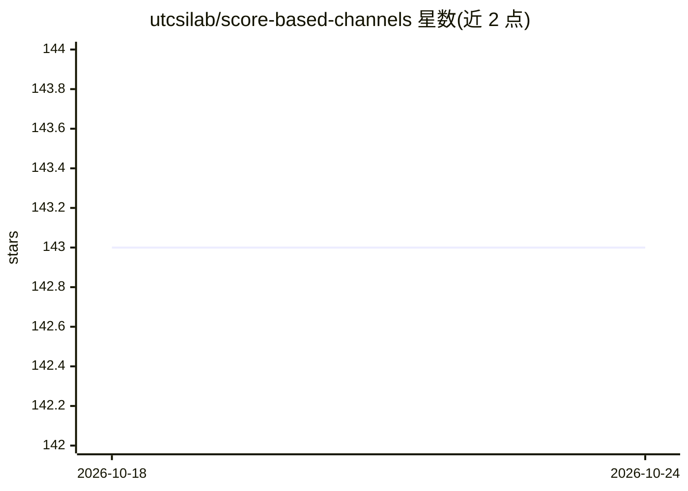

# utcsilab/score-based-channels

⭐ 143 · Python · NOASSERTION · 推送 2026-05-11 · [GitHub](https://github.com/utcsilab/score-based-channels) · 组织维护

**基于扩散模型的 MIMO 信道估计论文源码，供科研复现**

IEEE TWC 论文 "MIMO Channel Estimation using Score-Based Generative Models" 的源码仓库：在 CDL 系列信道模型上训练与测试 score-based（扩散）生成模型进行 MIMO 信道估计，并包含其他对比算法。提供 CDL-C 预生成训练/验证数据与预训练权重的命令行下载，支持训练、信道估计推理、alpha/beta/N 超参数网格搜索；另附 MATLAB 脚本用于生成信道数据集（需 MATLAB 许可证）。推荐用 uv 管理依赖，pip 路径仅限 Ubuntu + Python 3.11。基于 ncsnv2 代码库。

## 筛选速览

| 维度 | 判定 | 备注 |
|---|---|---|
| AI 角色 | `ai-native` | 本体是模型或模型工具 |
| 许可风险 | `none` | NOASSERTION |
| 部署形态 | `library` | 以包/库形式分发 |
| 模型依赖 | — | README 未给出锁定关系 |
| 硬件要求 | — | 无带数字的原话,不猜 |
| 安装摩擦 | `low` | 无编译、无系统依赖或容器化 |
| 成熟度 | — | 结构信号不足 |

## 能力要点

- 在 CDL-A/B/C/D 信道上训练与测试 score-based 扩散模型
- 提供预生成数据与预训练权重的 curl 下载命令
- 支持 Annealed Langevin Dynamics 推理超参数（alpha/beta/N）网格搜索
- 附 MATLAB 脚本生成训练/测试信道数据集

## 适用场景

- 复现论文中 Figure 5c 的信道估计结果曲线
- 在 CDL 信道分布上训练扩散模型并做信道估计
- 调节推理超参数以适配不同信道分布
- 生成自定义 MIMO 信道训练数据

## 场景标签

`科研工具` · 领域:学习与行业

## 证据(README 行号)

> L1: # MIMO Channel Estimation using Score-Based (Diffusion) Generative Models
> L6: This repository contains source code for MIMO Channel Estimation using Score-Based Generative Models, and contains c
> L71: To run channel estimation with the CDL-C data and the pretrained model run:

## 星数曲线

2026-10-18 143 → 2026-10-24 143（+0）

---
*卡片 v1 · prompt 1.4 · 生成 2026-10-22 · 置信度 high · 依据 README sha `cca63aacf7d3` · [字段定义](../../DATASET.md)*
