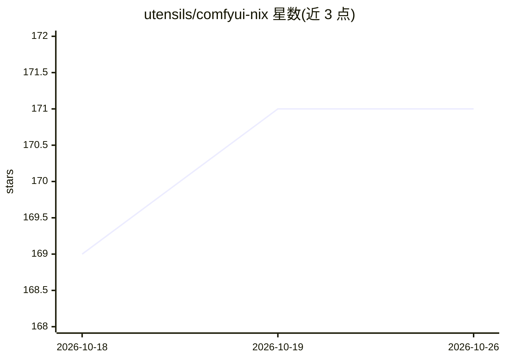

# utensils/comfyui-nix

⭐ 171 · Nix · MIT · 推送 2026-09-27 · [GitHub](https://github.com/utensils/comfyui-nix) · [官网](https://flakehub.com/flake/utensils/comfyui) · 个人维护

**ComfyUI 的 Nix flake 打包：NixOS/macOS/Linux 可复现运行**

以纯 Nix flake 形式打包 ComfyUI（Python 3.12）并附带策展的第三方自定义节点（Impact Pack、rgthree、KJNodes、GGUF、LTXVideo、Florence2 等）。提供 CUDA/ROCm/XPU 变体，均基于 pytorch.org 预编译 wheel，构建下载约 2-2.5GB；CUDA 13 运行时与 ROCm 库随闭包捆绑，NVIDIA 驱动需 580 以上。支持 NixOS 声明式模块以系统服务运行，ComfyUI Manager 的自定义节点依赖装入 PEP 405 venv 以保持 Nix store 只读。面向 NixOS/macOS Apple Silicon 及 Linux NVIDIA/AMD/Intel GPU 用户。

## 筛选速览

| 维度 | 判定 | 备注 |
|---|---|---|
| AI 角色 | `ai-ecosystem` | LLM/agent 周边工具 |
| 许可风险 | `permissive` | MIT |
| 部署形态 | `self-host` | docker 或自建部署 |
| 模型依赖 | — | README 未给出锁定关系 |
| 硬件要求 | — | 无带数字的原话,不猜 |
| 安装摩擦 | `low` | 无编译、无系统依赖或容器化 |
| 成熟度 | `idea` | |

## 能力要点

- CUDA/ROCm/XPU 三种 GPU 后端变体，基于预编译 PyTorch wheel
- NixOS 声明式模块可将 ComfyUI 作为系统服务运行
- 内置 ComfyUI Manager，节点依赖装入 .venv 保持 Nix store 只读
- 捆绑 Model Downloader、Impact Pack、GGUF、Florence2 等自定义节点

## 适用场景

- NixOS 用户声明式安装运行 ComfyUI
- 在不污染系统 Python 的隔离环境中跑 ComfyUI
- 在 NVIDIA/AMD/Intel GPU 上通过预编译 wheel 快速部署

## 场景标签

`图像生成` · 领域:内容生成

## 证据(README 行号)

> L153: ComfyUI's standard installation relies on pip and manual dependency management, which doesn't integrate well with 
> L155: - **NixOS compatibility**: A first-class option for NixOS users who previously had no clean way to run ComfyUI
> L158: - **Declarative configuration**: NixOS module for running ComfyUI as a system service with declarative custom node

## 星数曲线

2026-10-18 169 → 2026-10-26 171（+2）

---
*卡片 v1 · prompt 1.4 · 生成 2026-10-22 · 置信度 mid · 依据 README sha `3ae7ef2efdd0` · [字段定义](../../DATASET.md)*
