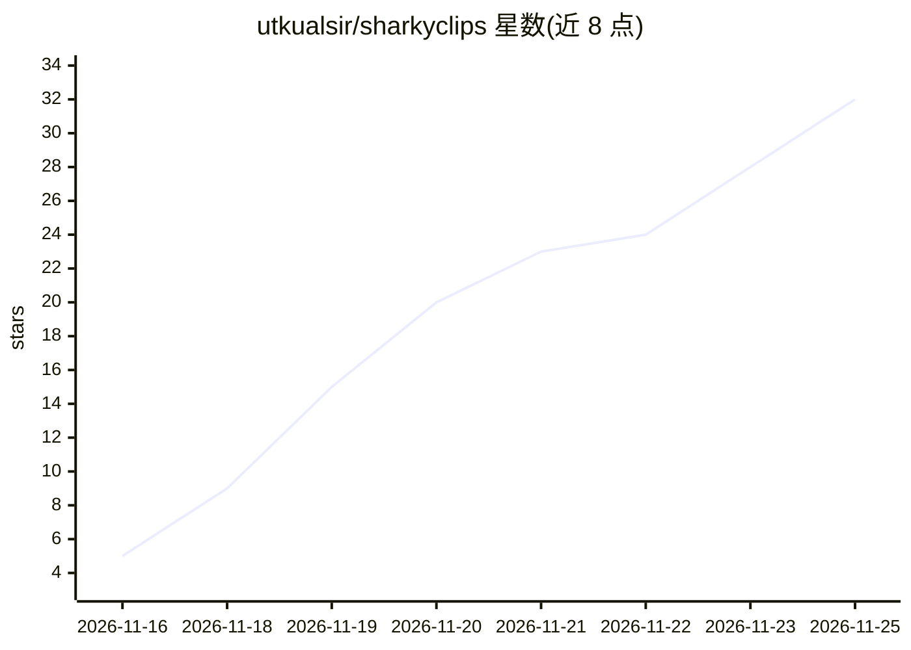

# utkualsir/sharkyclips

⭐ 32 · Python · MIT · 推送 2026-11-22 · [GitHub](https://github.com/utkualsir/sharkyclips) · [官网](https://utkualsir.github.io/sharkyclips-site/) · 个人维护

**给主播的本地 AI 短视频剪辑工具，自动生成可发布的竖屏切片**

面向 Twitch/YouTube/Kick 主播的桌面应用：读取 VOD 或本地视频，通过本地 Whisper 转录、聊天回放与游戏 HUD 分析（RapidOCR）、信号评分生成 Hype Map 排名切片候选，裁切 9:16 竖屏片段、消音脏话、用本地语言模型写标题与描述，并可一键发布到 YouTube Shorts/TikTok/Instagram Reels。全部推理与渲染在本地 GPU/CPU 运行，无账号、无云端。MIT 许可，提供 Windows/macOS 一键安装器，更新经 git 进行。

## 筛选速览

| 维度 | 判定 | 备注 |
|---|---|---|
| AI 角色 | `ai-native` | 本体是模型或模型工具 |
| 许可风险 | `permissive` | MIT |
| 部署形态 | `library` | 以包/库形式分发 |
| 模型依赖 | local-ok | 支持本地模型 |
| 硬件要求 | `gpu-8g` | |
| 安装摩擦 | `medium` | 含编译或系统依赖之一 |
| 成熟度 | — | 结构信号不足 |

## 能力要点

- 本地 Whisper 转录 + Hype Map 切片候选排名
- 本地语言模型写标题、评分并按频道数据校准
- 7 语言脏话消音与渲染后复检
- 一键发布 YouTube Shorts/TikTok/Instagram Reels

## 适用场景

- 把直播 VOD 自动切成 Shorts 并定时发布
- 直播时用 !clip 或快捷键标记精彩时刻
- 多语言字幕与脏话消音的切片后期

## 场景标签

`语音识别` · 领域:感知与多模态

## 证据(README 行号)

> L32:  🔒 Free &amp; local Whisper, the language model, highlight detection and rendering run on your GPU or CPU. MIT-lice
> L77: |Language model|Ollama with Qwen 3.5 (4B / 9B, picked from your VRAM), structured JSON output|
> L164: account, no cloud service, no paid API and no telemetry. Transcription (Whisper), the language model (Qwen 3.5 via

## 星数曲线

2026-11-16 5 → 2026-11-25 32（+27）

---
*卡片 v1 · prompt 1.4 · 生成 2026-11-19 · 置信度 mid · 依据 README sha `cbde41c7a3e4` · [字段定义](../../DATASET.md)*
