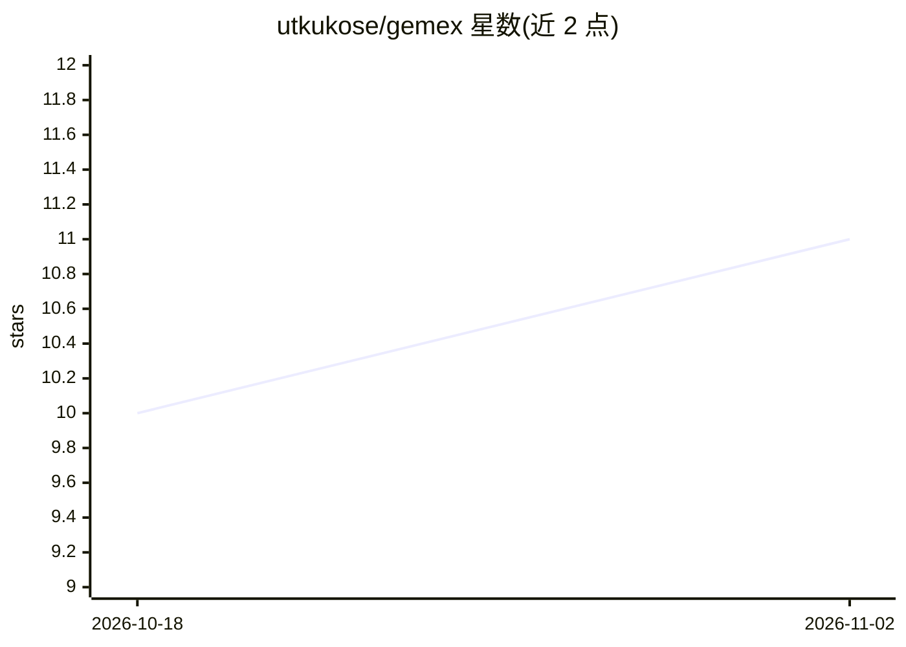

# utkukose/gemex

⭐ 11 · Python · NOASSERTION · 推送 2026-06-04 · [GitHub](https://github.com/utkukose/gemex) · 组织维护

**模型无关的可解释 AI 库：用黎曼信息几何解释任意 ML 模型**

基于黎曼信息几何与微分几何的 XAI Python 库（pip 安装，Python 3.8+，MIT 许可）：把训练好的模型视为带 Fisher 信息度量的统计流形，沿测地路径积分得到 Geodesic Sensitivity Field（GSF）归因分数，输出 13 种可视化，涵盖归因柱图、力图、瀑布图、蜂群图、并行输运交互网络、测地弧长剖面、注意力驻留分析、Bias Trap 检测（HAT/MCA 指标）等。声称模型无关，支持表格、时间序列与图像。GSF 分数在特征重参数化下不变。作者为大学教授，论文被 IEEE ICHORA 2026 接收。

## 筛选速览

| 维度 | 判定 | 备注 |
|---|---|---|
| AI 角色 | `ai-ecosystem` | LLM/agent 周边工具 |
| 许可风险 | `permissive` | NOASSERTION |
| 部署形态 | `library` | 以包/库形式分发 |
| 模型依赖 | — | README 未给出锁定关系 |
| 硬件要求 | — | 无带数字的原话,不猜 |
| 安装摩擦 | `low` | 无编译、无系统依赖或容器化 |
| 成熟度 | — | 结构信号不足 |

## 能力要点

- GSF 归因分数具有重参数化不变性（如 cm→m 缩放不改变归因）
- 13 种可视化，含测地弧长剖面、注意力驻留、Bias Trap 检测
- Bias Trap 审计由 HAT/MCA 等三个几何指标叠加评分
- 模型无关，支持表格数据、时间序列与图像

## 适用场景

- 解释任意已训练 ML 模型的单条或批量预测
- 审计模型是否存在对敏感特征的隐性偏倚（Bias Trap）
- 向临床或技术受众展示各特征对预测的逐步贡献

## 场景标签

 · 领域:机器学习可解释性/科学计算

## 证据(README 行号)

> L21: **GEMEX** explains *any* machine learning model — tabular data, time series, or
> L6: *The first XAI library grounded in Riemannian information geometry*
> L12: Accepted: IEEE ICHORA 2026

## 星数曲线

2026-10-18 10 → 2026-11-02 11（+1）

---
*卡片 v1 · prompt 1.4 · 生成 2026-11-02 · 置信度 high · 依据 README sha `244b82358df0` · [字段定义](../../DATASET.md)*
