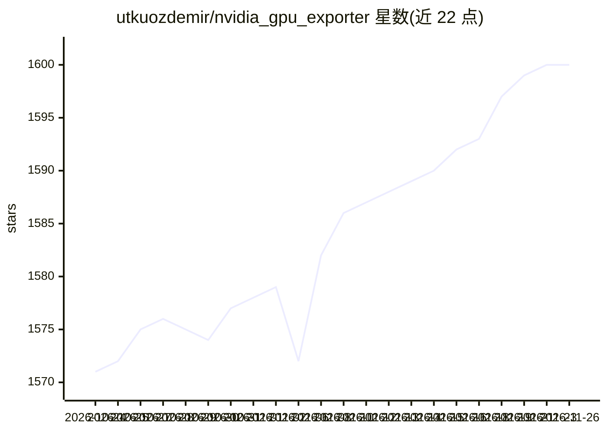

# utkuozdemir/nvidia_gpu_exporter

⭐ 1,600 · Go · MIT · 推送 2026-11-25 · [GitHub](https://github.com/utkuozdemir/nvidia_gpu_exporter) · 个人维护

**NVIDIA GPU 的 Prometheus 监控导出器，读取 NVML 或 nvidia-smi**

面向 NVIDIA GPU 的 Prometheus exporter：通过驱动库 NVML（进程内读取）或 nvidia-smi 子进程两种后端采集利用率、显存、功耗、温度、时钟、ECC 错误、编解码器统计等指标，输出 nvidia_smi_* 前缀的指标；可将每进程 GPU 使用归因到 Docker/containerd/systemd 服务（含 ollama.service）与 MIG 实例。跨 Linux/Windows/macOS，支持裸机、Docker、Kubernetes 部署，附两个官方 Grafana 仪表盘。维护者声明这是业余维护的副业项目，响应可能较慢。

## 筛选速览

| 维度 | 判定 | 备注 |
|---|---|---|
| AI 角色 | `ai-enhanced` | 去掉 AI 部分产品仍成立 |
| 许可风险 | `permissive` | MIT |
| 部署形态 | `self-host` | docker 或自建部署 |
| 模型依赖 | — | README 未给出锁定关系 |
| 硬件要求 | — | 无带数字的原话,不猜 |
| 安装摩擦 | `low` | 无编译、无系统依赖或容器化 |
| 成熟度 | — | 结构信号不足 |

## 能力要点

- 双采集后端：NVML 进内读取或 nvidia-smi 子进程（零 C 绑定静态二进制）
- 每进程 GPU 使用归因到容器、systemd 服务与 MIG 实例
- 无 GPU 时可用 demo 后端输出合成指标
- 两个官方 Grafana 仪表盘与 Helm chart/包管理器多平台分发

## 适用场景

- 为消费级 GeForce/RTX 显卡、工作站和家庭实验室加 GPU 指标与告警
- Kubernetes 集群按 namespace/pod/container 汇总 GPU 利用率
- 通过 ssh 包装命令远程采集另一台主机的 GPU 指标

## 场景标签

 · 领域:运维/可观测性

## 证据(README 行号)

> L17: Prometheus exporter for NVIDIA GPUs, reading metrics directly from the NVIDIA driver library (NVML) or through `nvi
> L18: Can also attribute per-process GPU usage to containers, systemd services and MIG instances.
> L26: The exporter collects utilization, memory, power, thermals, clocks, throttling reasons, ECC errors, encoder/decoder

## 星数曲线

2026-10-24 1,571 → 2026-11-26 1,600（+29）

---
*卡片 v1 · prompt 1.4 · 生成 2026-11-23 · 置信度 high · 依据 README sha `91fb7fb20a02` · [字段定义](../../DATASET.md)*
