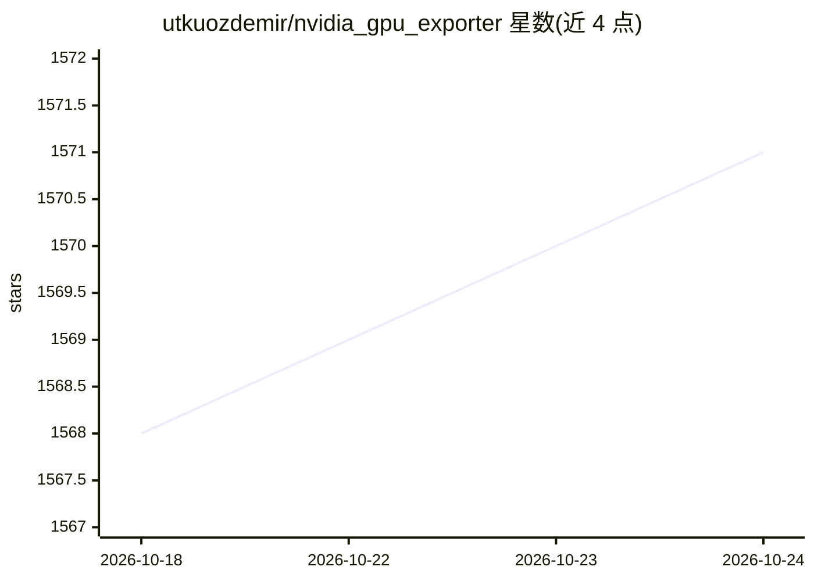

# utkuozdemir/nvidia_gpu_exporter

⭐ 1,572 · Go · MIT · 推送 2026-10-24 · [GitHub](https://github.com/utkuozdemir/nvidia_gpu_exporter) · 个人维护

**基于 nvidia-smi/NVML 的 NVIDIA GPU Prometheus 指标导出器**

面向 Prometheus 的 GPU 监控导出器：调用 nvidia-smi 二进制采集、解析并导出 GPU 利用率、显存、功耗、温度等指标，也可改用 NVML 后端直接读取驱动库，额外提供 MIG 实例、XID 错误计数、能耗与 PCIe 吞吐指标。运行于 Linux/Windows/macOS，支持裸机、Docker、Kubernetes（Helm chart），可远程执行 nvidia-smi、按进程统计显存、后台定时采集，附带两个官方 Grafana 仪表盘。作者声明为业余维护的 side project，议题处理可能延迟。目标用户为运维与家庭实验室场景；另有无需 GPU 的 demo 模式。

## 筛选速览

| 维度 | 判定 | 备注 |
|---|---|---|
| AI 角色 | `ai-enhanced` | 去掉 AI 部分产品仍成立 |
| 许可风险 | `permissive` | MIT |
| 部署形态 | `desktop` | 安装包/桌面程序 |
| 模型依赖 | — | README 未给出锁定关系 |
| 硬件要求 | — | 无带数字的原话,不猜 |
| 安装摩擦 | `low` | 无编译、无系统依赖或容器化 |
| 成熟度 | `idea` | |

## 能力要点

- 仅依赖 nvidia-smi 二进制即可运行，覆盖 Linux/Windows/macOS，无需 C 绑定
- 可选 NVML 后端提供 MIG 实例、XID 错误计数、能耗与 PCIe 吞吐等额外指标
- 支持远程执行 nvidia-smi、按进程 GPU 显存统计与后台定时采集
- 附带两个官方 Grafana 仪表盘，Helm chart 可自动配置

## 适用场景

- 在 Prometheus + Grafana 中监控 GeForce/RTX 等消费级 GPU
- 小型 Kubernetes 集群或家庭实验室不装 GPU Operator 即可采集 GPU 指标
- vGPU、MIG 切片或受限容器中仍能获取基础 GPU 指标
- 游戏时在仪表盘上查看 GPU 状态

## 场景标签

 · 领域:监控/可观测性

## 证据(README 行号)

> L17: Nvidia GPU exporter for Prometheus, using the `nvidia-smi` binary to gather metrics.
> L25: This is a simple exporter that uses the `nvidia-smi(.exe)` binary to collect,

## 星数曲线

2026-10-18 1,568 → 2026-10-24 1,571（+3）

---
*卡片 v1 · prompt 1.4 · 生成 2026-10-21 · 置信度 high · 依据 README sha `d3adb38772bc` · [字段定义](../../DATASET.md)*
