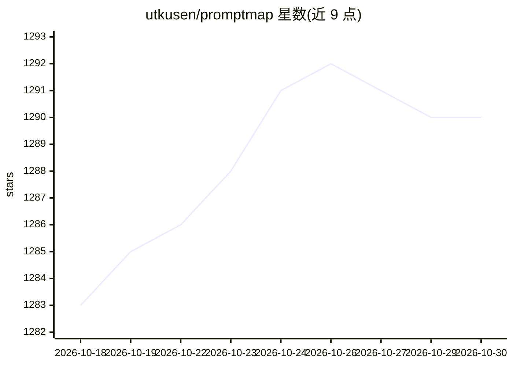

# utkusen/promptmap

⭐ 1,290 · Python · GPL-3.0 · 推送 2025-12-01 · [GitHub](https://github.com/utkusen/promptmap) · 个人维护

**面向自建 LLM 应用的自动化提示注入安全扫描器**

promptmap2 用于检测自定义 LLM 应用中的提示注入漏洞，2023 年首发、2025 年完全重写。支持白盒（提供系统提示词与模型信息）与黑盒（通过 YAML 配置指向任意 HTTP 端点）两种测试模式，采用双 LLM 架构：目标 LLM 接收攻击提示词，独立的控制器 LLM 依据 YAML 规则中的通过/失败条件判定攻击是否成功。内置 50+ 条规则，覆盖提示词窃取、越狱、有害内容、仇恨言论、社会偏见等 6 类，并支持防火墙 LLM 评测模式与 JSON 结果输出。以 Python 脚本形式从源码运行。

## 筛选速览

| 维度 | 判定 | 备注 |
|---|---|---|
| AI 角色 | `ai-ecosystem` | LLM/agent 周边工具 |
| 许可风险 | `viral` | GPL-3.0 |
| 部署形态 | `library` | 以包/库形式分发 |
| 模型依赖 | local-ok | 支持本地模型 |
| 硬件要求 | — | 无带数字的原话,不猜 |
| 安装摩擦 | `low` | 无编译、无系统依赖或容器化 |
| 成熟度 | — | 结构信号不足 |

## 能力要点

- 白盒与黑盒（HTTP 端点 YAML 配置）两种测试模式
- 双 LLM 架构：独立控制器 LLM 判定攻击成败
- 50+ 内置规则，覆盖提示窃取/越狱/有害内容/偏见等 6 类
- 支持防火墙 LLM 专项评测与 JSON 结果输出

## 适用场景

- 上线前扫描自建 LLM 应用的提示注入漏洞
- 对只有 HTTP 接口的第三方 LLM 服务做黑盒安全测试
- 评估部署在目标 LLM 前的防火墙 LLM 拦截效果

## 场景标签

`网络安全` `模型评测` · 领域:评测与运维

## 证据(README 行号)

> L8: promptmap2 is a an automated prompt injection scanner for custom LLM applications. It supports two testing modes:
> L14: It operates using a dual-LLM architecture:
> L19: The tool sends attack prompts to your target LLM and uses the controller LLM to evaluate whether the attack was suc

## 星数曲线

2026-10-18 1,283 → 2026-10-30 1,290（+7）

---
*卡片 v1 · prompt 1.4 · 生成 2026-10-21 · 置信度 mid · 依据 README sha `adc74abb1115` · [字段定义](../../DATASET.md)*
