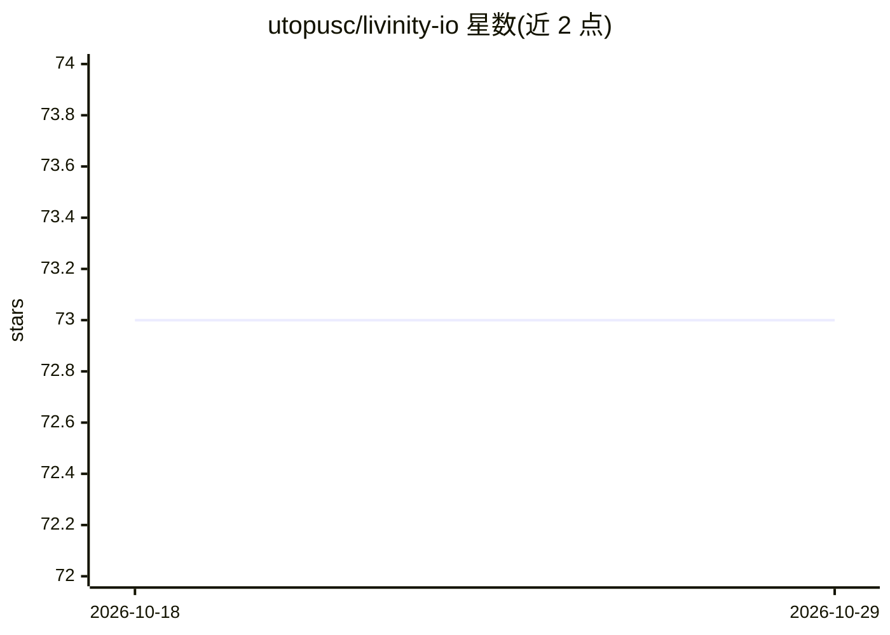

# utopusc/livinity-io

⭐ 73 · TypeScript · NOASSERTION · 推送 2026-08-04 · [GitHub](https://github.com/utopusc/livinity-io) · [官网](https://livinity.io/) · 组织维护

**自托管云端 AI 计算机：浏览器里的操作系统与应用商店**

运行在自有 Linux 主机上的浏览器操作系统，提供桌面、31 个一键安装的 Docker 应用目录、文件管理、浏览器终端、Docker 管理与多用户隔离。AI 助手 Liv 可安装应用、搜文件、跑任务，带向量记忆，默认 Anthropic Claude、可换 Google Gemini，自带 key；亦可通过 Ollama/Open WebUI 应用使用本地模型。安装为一行 curl 脚本，自动部署 Docker、Caddy、PostgreSQL、Redis 与 Cloudflare 隧道；提供付费托管云版本。AGPL-3.0。

## 筛选速览

| 维度 | 判定 | 备注 |
|---|---|---|
| AI 角色 | `ai-enhanced` | 去掉 AI 部分产品仍成立 |
| 许可风险 | `viral` | NOASSERTION |
| 部署形态 | `None` |  |
| 模型依赖 | local-ok | 支持本地模型 |
| 硬件要求 | — | 无带数字的原话,不猜 |
| 安装摩擦 | `low` | 无编译、无系统依赖或容器化 |
| 成熟度 | — | 结构信号不足 |

## 能力要点

- 31 个一键 Docker 应用（含 Ollama、Nextcloud、Jellyfin 等），自动 HTTPS 与健康检查
- AI 助手 Liv：Claude/Gemini BYOK，持久向量记忆，可执行应用/文件/Shell/Docker 工具
- MCP server、tRPC API、TypeScript Skills SDK、Webhook 与调度器等开发者接口
- Telegram/Discord/WhatsApp 渠道对话，无需公网 IP（Cloudflare 隧道）

## 适用场景

- 在家庭服务器上一键部署并管理自托管应用，替代 SaaS 订阅
- 通过对话让 AI 助手安装应用、找文件、执行系统操作
- 从任意设备的浏览器访问自己的桌面、文件与终端

## 场景标签

`AI 助手` · 领域:对话与助手

## 证据(README 行号)

> L23: **Livinity is an open-source, self-hostable "Cloud AI Computer."** It's a complete operating system — desktop, app 
> L64: |🧠 **Liv**|A dashboard-native AI assistant that does real work — installs apps, searches files, runs background job

## 星数曲线

2026-10-18 73 → 2026-10-29 73（+0）

---
*卡片 v1 · prompt 1.4 · 生成 2026-10-24 · 置信度 high · 依据 README sha `c2755e78d241` · [字段定义](../../DATASET.md)*
