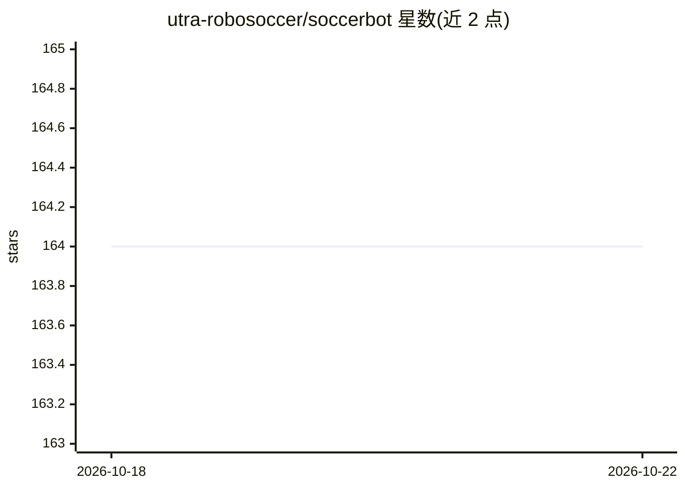

# utra-robosoccer/soccerbot

⭐ 164 · C · BSD-3-Clause · 推送 2026-06-13 · [GitHub](https://github.com/utra-robosoccer/soccerbot) · [官网](https://utra-robosoccer.github.io/) · 组织维护

**多伦多大学 RoboCup 人形机器人足球队的机器人软件栈**

多伦多大学 UTRA RoboSoccer 团队（自 2017 年从零搭建机器人）的 Repo，覆盖机械、电控、嵌入式与软件子系统，基于 ROS/ROS2 控制名为 Bez 的人形机器人参加 RoboCup 人形组比赛。软件包含双足步态控制（soccer_pycontrol）、轨迹测试、基于 PyTorch/Ultralytics 的物体检测节点（soccer_object_detection，支持 Jetson/aarch64 上的 Torch 安装）、URDF/Xacro 模型生成（配合 Blender/Phobos）与 Webots 仿真（提供 Docker 镜像 CI）。README 主要是团队命令记录式说明，正式上手文档在 GitHub Wiki。

## 筛选速览

| 维度 | 判定 | 备注 |
|---|---|---|
| AI 角色 | `ai-enhanced` | 去掉 AI 部分产品仍成立 |
| 许可风险 | `permissive` | BSD-3-Clause |
| 部署形态 | `self-host` | docker 或自建部署 |
| 模型依赖 | — | README 未给出锁定关系 |
| 硬件要求 | — | 无带数字的原话,不猜 |
| 安装摩擦 | `low` | 无编译、无系统依赖或容器化 |
| 成熟度 | — | 结构信号不足 |

## 能力要点

- 基于 ROS2 的双足步态控制与行走测试模块
- PyTorch + Ultralytics 物体检测节点，含 Jetson aarch64 安装路径
- 提供 Docker 镜像与 Webots 仿真 Docker 镜像 CI
- Xacro/URDF 机器人模型生成（配合 Blender 与 Phobos）

## 适用场景

- 在实体机器人或仿真中运行 RoboCup 人形组足球比赛软件
- 机器人步态与轨迹的 pytest 实机测试
- 参考高校机器人团队的 ROS2 软件组织方式

## 场景标签

 · 领域:机器人/具身智能

## 证据(README 行号)

> L11: The initial efforts to form new team within UTRA began summer 2016. However, it was not until summer 2017 that we w
> L50: pytest src/soccerbot/soccer_object_detection/src/soccer_object_detection/test_object_detection.py::TestObjectDetect
> L53: Torch https://forums.developer.nvidia.com/t/pytorch-for-jetson/72048

## 星数曲线

2026-10-18 164 → 2026-10-22 164（+0）

---
*卡片 v1 · prompt 1.4 · 生成 2026-10-22 · 置信度 low · 依据 README sha `f7a391dea4db` · [字段定义](../../DATASET.md)*
