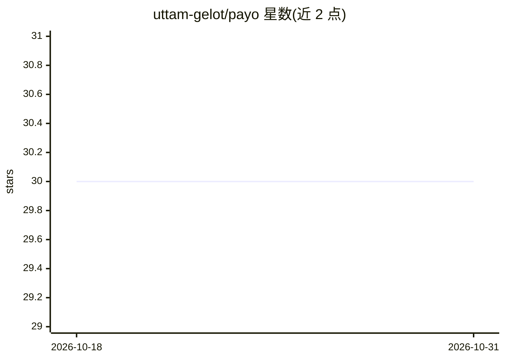

# uttam-gelot/payo

⭐ 30 · TypeScript · MIT · 推送 2026-10-24 · [GitHub](https://github.com/uttam-gelot/payo) · [官网](http://payo.uttamgelot.com/) · 个人维护

**CLI 工具：通过问卷访谈生成项目定制的 AI 编程助手规则与技能文件**

交互式 CLI，先就技术栈（语言、框架、数据库、认证、测试、约定等）向用户提问——题库含 200+ 个问题、覆盖 100+ 技术模块，且会按回答自适应；也可从 package.json、go.mod、Cargo.toml 等清单及本地 git 历史自动检测已有项目的栈与约定，再生成 AGENTS.md 与 .agents/skills/ 下的技能文件，供 Claude Code、Cursor、Copilot、Codex、Windsurf、Zed、Antigravity 等工具读取。已安装对应 agent CLI 时由其 AI 并行生成，否则回退到模板；可写 git hook 与 pre-tool gate 强制执行约定。无后端、无账户、无遥测，生成完全在本地进行；未装 agent CLI 时内容不出本机。

## 筛选速览

| 维度 | 判定 | 备注 |
|---|---|---|
| AI 角色 | `ai-ecosystem` | LLM/agent 周边工具 |
| 许可风险 | `permissive` | MIT |
| 部署形态 | `desktop` | 安装包/桌面程序 |
| 模型依赖 | locked-api |  |
| 硬件要求 | — | 无带数字的原话,不猜 |
| 安装摩擦 | `low` | 无编译、无系统依赖或容器化 |
| 成熟度 | — | 结构信号不足 |

## 能力要点

- 问卷+清单+本地 git 历史检测技术栈与约定，题库 200+ 题覆盖 100+ 技术模块
- 生成 AGENTS.md 与 .agents/skills/ 通用布局，多工具经 symlink 共享同一份技能文件
- 调用本机已装的 agent CLI（claude/codex/cursor-agent/copilot/agy）生成内容，无 CLI 时回退模板
- 可生成 git hook 与原生 pre-tool gate 强制执行规范；运行进度存于 .payo/ 可断点续跑

## 适用场景

- 新仓库初始化时让 AI 助手从第一次提交就遵循项目约定
- 团队统一各贡献者 AI 助手遵循的目录结构、命名与测试/git 规则
- 在多个 AI 编程工具间切换时共享同一套项目指导文件
- 接入不熟悉的技术栈时获取框架特定的默认约定与引导提示词

## 场景标签

`提示工程` · 领域:Agent 开发

## 证据(README 行号)

> L21: interactive CLI that **interviews you about your project** — language, framework,
> L75: It runs the agent CLI you already have installed and authenticated — `claude`,

## 星数曲线

2026-10-18 30 → 2026-10-31 30（+0）

---
*卡片 v1 · prompt 1.4 · 生成 2026-10-26 · 置信度 high · 依据 README sha `5f05c6005b77` · [字段定义](../../DATASET.md)*
