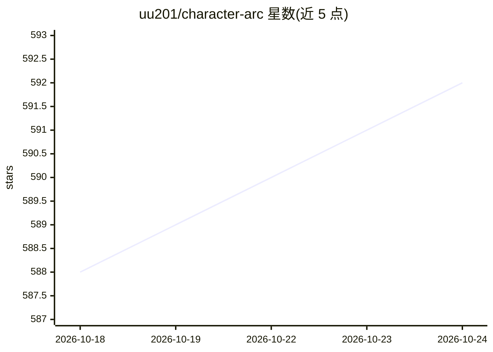

# uu201/character-arc

⭐ 592 · TypeScript · MIT · 推送 2026-10-24 · [GitHub](https://github.com/uu201/character-arc) · 个人维护 · 中文 README

**面向小说创作者的本地优先 AI 写作桌面工作台**

基于 Electron + Vue 3 + TypeScript 的小说创作桌面应用：以项目为单位组织世界观、角色关系、剧情大纲与章节正文，数据存于本机 SQLite，不依赖在线服务。AI 能力覆盖章节初稿流程（备忘→初稿→审计→修复→去 AI 味）、续写润色、伏笔识别、Agent Loop 调度与封面生成，按任务匹配内置 28 个 Skill 或项目级 Skill 包。接入方式包括本机 Codex CLI、OpenAI 兼容接口与 Anthropic 协议。源码构建需 Node.js 18+ 与 pnpm 10+，macOS 产物为未公证的 ad-hoc 签名包。

## 筛选速览

| 维度 | 判定 | 备注 |
|---|---|---|
| AI 角色 | `ai-native` | 本体是模型或模型工具 |
| 许可风险 | `permissive` | MIT |
| 部署形态 | `desktop` | 安装包/桌面程序 |
| 模型依赖 | local-ok | 支持本地模型 |
| 硬件要求 | — | 无带数字的原话,不猜 |
| 安装摩擦 | `low` | 无编译、无系统依赖或容器化 |
| 成熟度 | — | 结构信号不足 |

## 能力要点

- 本地优先：项目数据存本机 SQLite，不上传第三方服务
- 章节初稿流程：备忘→初稿→审计→自动修复/去 AI 味/写作日志
- 内置 3 组共 28 个 Skill 包，支持项目级 Skill 导入与 Agent Loop 调度
- 多厂商接入：Codex CLI、OpenAI 兼容接口、Anthropic 协议

## 适用场景

- 长期维护小说项目设定、角色关系与剧情大纲
- 借助 AI 生成章节初稿并做多轮润色去 AI 味
- 拆解参考作品沉淀风格与知识库
- 为番茄、起点等平台生成封面 Prompt 与预览图

## 场景标签

`AI 写作` `图像生成` · 领域:内容生成

## 证据(README 行号)

> L28: CharacterArc（弧光）不是"只会对话的 AI 壳子"，而是一套围绕小说项目组织、章节写作与 AI 协作搭起来的桌面工作台。
> L74: - 章节润色、续写、改写、节奏调整

## 星数曲线

2026-10-18 588 → 2026-10-24 592（+4）

---
*卡片 v1 · prompt 1.4 · 生成 2026-10-21 · 置信度 high · 依据 README sha `3d2ee41738fd` · [字段定义](../../DATASET.md)*
