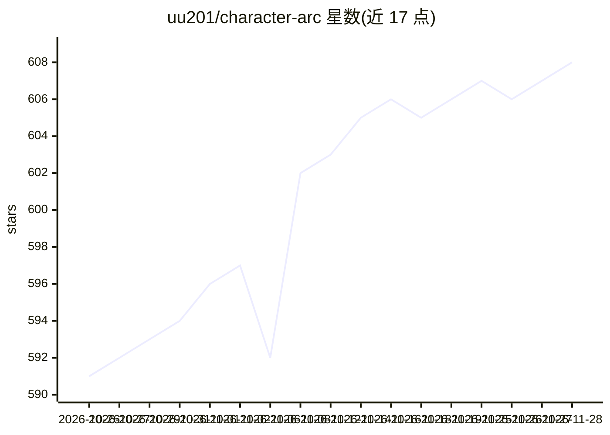

# uu201/character-arc

⭐ 608 · JavaScript · MIT · 推送 2026-11-27 · [GitHub](https://github.com/uu201/character-arc) · 个人维护 · 中文 README

**面向小说创作者的 AI 桌面写作工作台，管理设定、大纲与章节**

基于 Electron + Vue 3 的本地优先小说创作桌面应用：项目数据存于本机 SQLite，按项目维护世界观、角色关系、剧情大纲、章节正文与知识库。AI 部分通过 OpenAI 兼容协议、Anthropic 协议或本机 Codex CLI 接入多厂商模型，提供章节润色、续写、初稿流程、Agent Loop 与 Skill 包调度；内置 3 组共 30 个写作类 Skill。Windows 打 NSIS 包，macOS 打 DMG/ZIP，从源码运行需 Node.js 18+ 与 pnpm 10+。

## 筛选速览

| 维度 | 判定 | 备注 |
|---|---|---|
| AI 角色 | `ai-native` | 本体是模型或模型工具 |
| 许可风险 | `permissive` | MIT |
| 部署形态 | `desktop` | 安装包/桌面程序 |
| 模型依赖 | local-ok | 支持本地模型 |
| 硬件要求 | — | 无带数字的原话,不猜 |
| 安装摩擦 | `low` | 无编译、无系统依赖或容器化 |
| 成熟度 | — | 结构信号不足 |

## 能力要点

- 本地 SQLite 存储，项目数据不上传第三方服务
- 多厂商接入：OpenAI 兼容接口、Anthropic 协议与本机 Codex CLI
- 内置 3 组共 30 个 Skill 包，支持 Agent Loop 调度与项目级 Skill 导入
- 章节初稿流程：备忘→初稿→审计→修复/去 AI 味

## 适用场景

- 长期维护一部小说的设定、伏笔与章节进度
- 用 AI 协作完成章节润色、续写与初稿生成
- 按番茄、起点等平台风格生成封面 Prompt 并出预览图
- 导入参考作品拆解风格并沉淀到知识库

## 场景标签

`AI 写作` `知识库管理` · 领域:内容生成

## 证据(README 行号)

> L28: CharacterArc（弧光）不是"只会对话的 AI 壳子"，而是一套围绕小说项目组织、章节写作与 AI 协作搭起来的桌面工作台。
> L43:  支持 Codex CLI、OpenAI 兼容接口（DeepSeek、通义千问、智谱、Kimi、SiliconFlow、Ollama 等）和 Anthropic 协议（官方及中转站）。

## 星数曲线

2026-10-26 591 → 2026-11-28 608（+17）

---
*卡片 v1 · prompt 1.4 · 生成 2026-11-28 · 置信度 high · 依据 README sha `b5f570dd6aab` · [字段定义](../../DATASET.md)*
