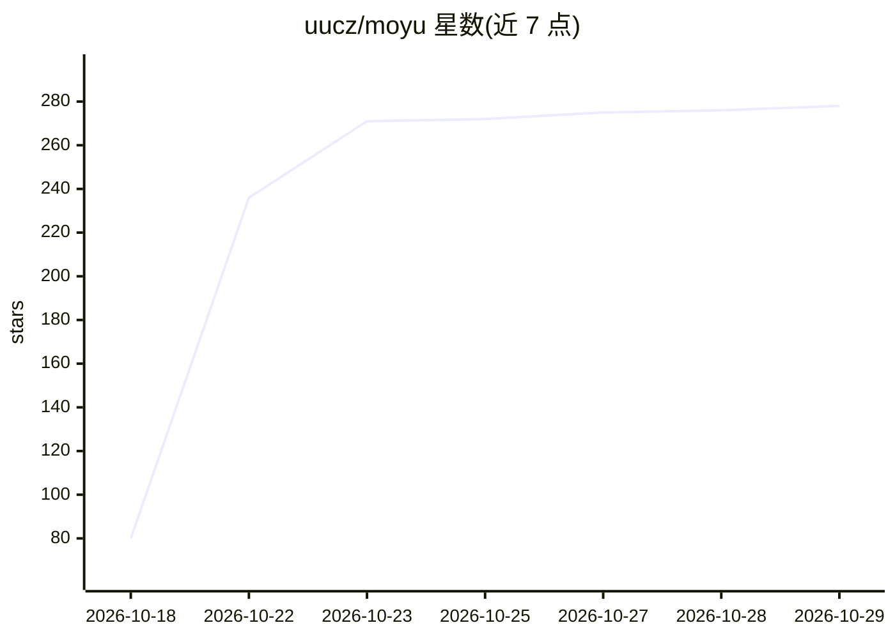

# uucz/moyu

⭐ 278 · Python · MIT · 推送 2026-07-30 · [GitHub](https://github.com/uucz/moyu) · [官网](https://uucz.github.io/moyu/) · 个人维护 · 中文 README

**约束 AI 编码助手少做废活的提示词技能包**

面向 Claude Code、Cursor、Copilot、Windsurf、Cline、Codex CLI、Kiro、Aider 等 12 个 AI 编程平台的规则/技能文件集合：通过三条铁律（只改被要求改的、最简方案优先、不确定就问）和 4 级过度工程检测规则，约束 AI 不引入未要求的抽象、依赖、注释与测试。以 curl 复制规则文件或 claude skill install 一行命令安装，安装后自动生效，也可手动激活。提供中/英/日/韩/法语言变体与 lite/strict 变体。附 1460 次控制实验数据，说明价值在于消除特定模型的讨好行为而非普适缩减代码量。

## 筛选速览

| 维度 | 判定 | 备注 |
|---|---|---|
| AI 角色 | `ai-ecosystem` | LLM/agent 周边工具 |
| 许可风险 | `permissive` | MIT |
| 部署形态 | `None` |  |
| 模型依赖 | — | README 未给出锁定关系 |
| 硬件要求 | — | 无带数字的原话,不猜 |
| 安装摩擦 | `low` | 无编译、无系统依赖或容器化 |
| 成熟度 | — | 结构信号不足 |

## 能力要点

- 三条铁律 + 4 级过度工程检测规则
- 支持 12 个 AI 编程平台（Claude Code/Cursor/Copilot/Windsurf 等）
- 5 种语言与 lite/strict 变体
- 附 1460 次控制实验数据（benchmark/）

## 适用场景

- 我的 AI 编码助手总是顺手重构没让改的代码
- 想减少 AI 生成代码里多余的抽象和依赖
- 在 Cursor/Claude Code 里约束 diff 范围、要求最简实现

## 场景标签

`提示工程` · 领域:Agent 开发

## 证据(README 行号)

> L29: claude skill install --url https://github.com/uucz/moyu --skill moyu
> L124: ## 安装
> L282: |平台|状态|维护|

## 星数曲线

2026-10-18 80 → 2026-10-29 278（+198）

---
*卡片 v1 · prompt 1.4 · 生成 2026-10-22 · 置信度 high · 依据 README sha `c8f3fc623755` · [字段定义](../../DATASET.md)*
