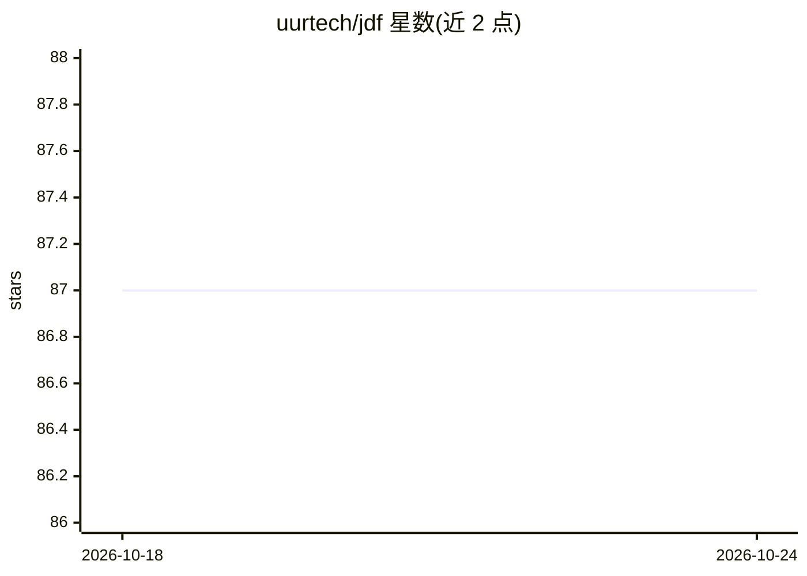

# uurtech/jdf

⭐ 87 · TypeScript · MIT · 推送 2026-10-14 · [GitHub](https://github.com/uurtech/jdf) · [官网](https://jdf.dev) · 组织维护

**面向 AI 时代的 JSON 文档格式，配套桌面阅读器、网页嵌入库与 CLI**

定义一种以 JSON 为源的文档格式：任意文本编辑器可打开源码，JDF Reader 桌面端可渲染、编辑、导入 PDF/MD 并导出 PDF；jdf.js 提供网页嵌入渲染；CLI 负责校验、格式转换及面向 RAG 的 chunk/embed。嵌入资源（图片/字体）时以 .jdfx zip 包形式单文件分发。格式带 JSON Schema 校验，git 可行级 diff，CLI 支持将 LLM 输出的 JSON 包装为合法 .jdf。macOS 的 .dmg 未签名，首次运行需移除隔离属性。

## 筛选速览

| 维度 | 判定 | 备注 |
|---|---|---|
| AI 角色 | `ai-enhanced` | 去掉 AI 部分产品仍成立 |
| 许可风险 | `permissive` | MIT |
| 部署形态 | `desktop` | 安装包/桌面程序 |
| 模型依赖 | — | README 未给出锁定关系 |
| 硬件要求 | — | 无带数字的原话,不猜 |
| 安装摩擦 | `medium` | 含编译或系统依赖之一 |
| 成熟度 | — | 结构信号不足 |

## 能力要点

- 同一 JSON 被桌面 Reader、jdf.js、CLI 三个运行面消费，Reader 与 jdf.js 保持渲染功能对齐
- JSON Schema（spec/jdf-schema.json）校验结构并支持 IDE 自动补全
- CLI 提供 PDF/JSON/MD→JDF 转换及 RAG 用 chunk、embed 命令
- PDF 导入保留位置、字体、颜色、形状与嵌入图像

## 适用场景

- 用纯文本工具链（git/jq/grep）管理文档并追踪行级变更
- 把 PDF/Markdown 转为可被程序与 LLM 直接读取的结构化文档
- 在网页中嵌入 .jdf 文档的渲染视图
- 把 LLM 生成的 JSON 包装为经校验的 .jdf 文档

## 场景标签

 · 领域:文档工具/文件格式

## 证据(README 行号)

> L6: A JSON document format built for the AI era. PDFs were designed for humans and printers; JDF is designed for the sys
> L16: |**`@uurtech/jdf-cli`**|CLI — validate, convert PDF/JSON/MD→JDF, and RAG-native `chunk` + `embed`|`brew tap uurtech
> L39: **The shift:** instead of *"AI trying to understand humans' files"*, humans start writing in a format already built

## 星数曲线

2026-10-18 87 → 2026-10-24 87（+0）

---
*卡片 v1 · prompt 1.4 · 生成 2026-10-23 · 置信度 low · 依据 README sha `756dc373b829` · [字段定义](../../DATASET.md)*
