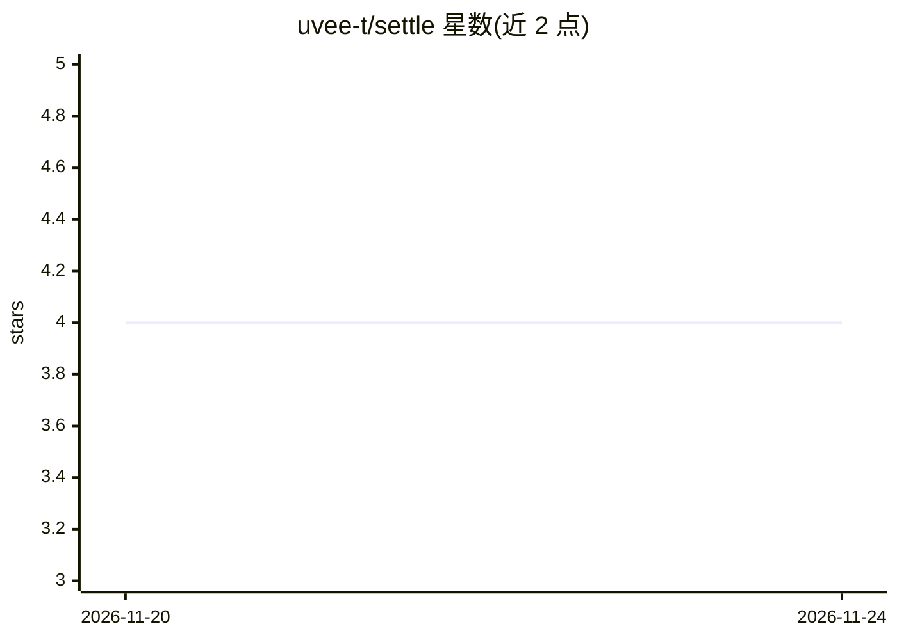

# uvee-t/settle

⭐ — · [GitHub]() · 个人维护

**给自由职业者/机构：合同提取、PayPal 开票与纠纷处理一体化工作台**

全栈 SaaS 应用，围绕合同到收款流程组织：AI 辅助从文档提取结构化合同事实，经人工审核后用于里程碑管理与 PayPal 发票工作流；同步 PayPal 纠纷记录，收集证据并生成 AI 辅助分析，须经 owner/admin 审批后才可提交。技术栈为 React/Vite 前端、TypeScript Fastify API、PostgreSQL、Redis/BullMQ 队列与对象存储，部署于 Render。README 明确标注为黑客松/演示项目，不应当作生产级金融或法律系统使用。

## 筛选速览

| 维度 | 判定 | 备注 |
|---|---|---|
| AI 角色 | `ai-enhanced` | 去掉 AI 部分产品仍成立 |
| 许可风险 | `permissive` | — |
| 部署形态 | `None` |  |
| 模型依赖 | — | README 未给出锁定关系 |
| 硬件要求 | — | 无带数字的原话,不猜 |
| 安装摩擦 | `low` | 无编译、无系统依赖或容器化 |
| 成熟度 | `idea` | |

## 能力要点

- AI 文档提取管线：异步生成结构化合同事实，输出经 schema 校验并需人工审核
- PayPal Sandbox 集成：发票、纠纷、报告、webhook 签名验证，工作区级 AES-256-GCM 加密凭证
- 证据包工作流：AI 生成分析草稿后必须经人工审批，不做自动法律判定
- Redis/BullMQ 后台任务、幂等支持、事务性 outbox 与速率限制

## 适用场景

- 把合同/SOW 中的关键日期与付款条件提取为可执行的里程碑
- 通过 PayPal Sandbox 演示从合同到开票、催款、对账的完整流程
- 同步 PayPal 纠纷并组织证据材料供人工审核

## 场景标签

`文档解析` · 领域:知识与检索

## 证据(README 行号)

> L7: Settle is a contract-to-cash workspace for freelancers and agencies. It helps turn contract and Statement of Work (S
> L51: - **AI document extraction:** asynchronous extraction of structured contract facts from supported documents.
> L174: **AI does not independently make a final legal determination or submit an evidence response without the applicatio

## 星数曲线

2026-11-20 4 → 2026-11-24 4（+0）

---
*卡片 v1 · prompt 1.4 · 生成 2026-11-21 · 置信度 high · 依据 README sha `edf1a6a6897a` · [字段定义](../../DATASET.md)*
