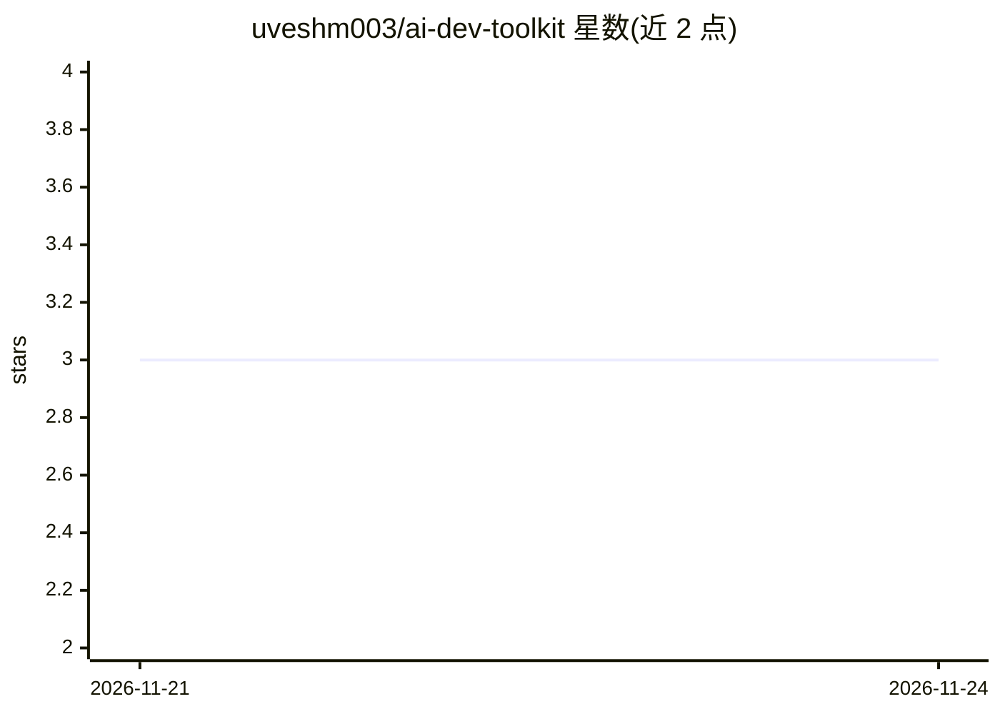

# uveshm003/ai-dev-toolkit

⭐ 3 · CC0-1.0 · 推送 2026-11-19 · [GitHub](https://github.com/uveshm003/ai-dev-toolkit) · 个人维护

**AI 编程智能体的技能/插件/MCP/工作流策展清单**

覆盖软件开发全生命周期及写作场景的 AI 编程智能体工具清单，收录技能、插件、MCP 服务器与工作流，按规划、编码、测试、评审、安全、部署等章节组织，并按 Top 10 与用户栈分类给出推荐组合。每条目说明用途、适用时机与安装命令，附官方来源、需 API key、兼容智能体三类标签，列表每周做链接校验，以 CC0 许可发布。

## 筛选速览

| 维度 | 判定 | 备注 |
|---|---|---|
| AI 角色 | `ai-knowledge` | 知识聚合/清单类 |
| 许可风险 | `viral` | CC0-1.0 |
| 部署形态 | `self-host` | docker 或自建部署 |
| 模型依赖 | — | README 未给出锁定关系 |
| 硬件要求 | — | 无带数字的原话,不猜 |
| 安装摩擦 | `low` | 无编译、无系统依赖或容器化 |
| 成熟度 | `idea` | |

## 能力要点

- 按 SDLC 全生命周期组织条目并排序
- 每条目含用途说明与安装命令，附官方/API key/兼容智能体标签
- 提供 Top 10 与按用户角色的推荐组合表
- 自述每周链接检查并复验安装命令

## 适用场景

- 为 Claude Code/Codex/Cursor 等智能体挑选技能与插件
- 按自己技术栈查找配套的智能体工具组合
- 了解 SDLC 各阶段的智能体工作流选项

## 场景标签

`精选清单` · 领域:学习与行业

## 证据(README 行号)

> L3: > The best **skills, plugins, MCP servers and workflows** for AI coding agents (Claude Code, Codex, Cursor, Copilot,
> L5: > Each entry says **what it does**, **when to use it** and **how to install it**. Within every section, the stronges
> L9:  License: CC0

## 星数曲线

2026-11-21 3 → 2026-11-24 3（+0）

---
*卡片 v1 · prompt 1.4 · 生成 2026-11-21 · 置信度 mid · 依据 README sha `13690d8682f8` · [字段定义](../../DATASET.md)*
