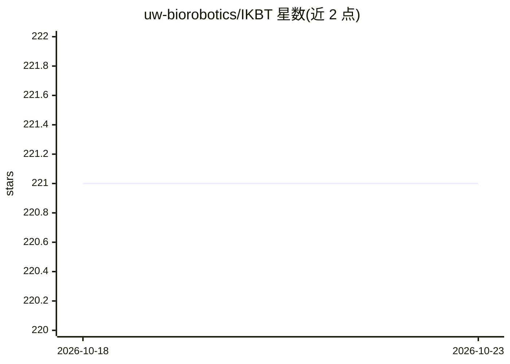

# uw-biorobotics/IKBT

⭐ 221 · Python · NOASSERTION · 推送 2026-10-14 · [GitHub](https://github.com/uw-biorobotics/IKBT) · [官网](https://www.jair.org/index.php/jair/article/view/11592) · 组织维护

**符号法求解机械臂逆运动学的 Python 系统，输出 LaTeX/Python/C++**

面向机器人研究者的逆运动学封闭解自动求解器：用行为树组织求解算法与人类专家知识，对串联非冗余机械臂求解，生成关节变量依赖图与全部解组合，并以 LaTeX 文档、Python 与 C++ 代码形式输出。依赖仅 Python 3.8 与 sympy，LaTeX 为推荐的公式输出依赖。用户在 ik_robots.py 中录入 DH 参数即可求解自有机型；正运动学结果可用 pickle 缓存。已发表 JAIR 2019 论文，IKBT2 候选版在另一分支。

## 筛选速览

| 维度 | 判定 | 备注 |
|---|---|---|
| AI 角色 | `ai-native` | 本体是模型或模型工具 |
| 许可风险 | `none` | NOASSERTION |
| 部署形态 | `None` |  |
| 模型依赖 | — | README 未给出锁定关系 |
| 硬件要求 | — | 无带数字的原话,不猜 |
| 安装摩擦 | `low` | 无编译、无系统依赖或容器化 |
| 成熟度 | `idea` | |

## 能力要点

- 行为树组织逆运动学求解算法与专家规则
- 生成关节变量依赖图并给出全部解组合
- 自动生成 LaTeX 文档与 Python/C++ 代码
- 仅依赖 sympy，跨平台，支持 pickle 缓存正运动学

## 适用场景

- 为我的机械臂推导封闭形式逆运动学解
- 生成可部署的 Python/C++ 运动学代码
- 复现论文中 18 个已测试机型的求解结果

## 场景标签

 · 领域:机器人/符号计算

## 证据(README 行号)

> L2: A python based system for generating closed-form solutions to the manipulator inverse kinematics problem using
> L3: behavior trees for action selection.
> L50:  1. We built an autonomous inverse kinematics solver (IKBT) using a behavior tree to organize solution algorithms.

## 星数曲线

2026-10-18 221 → 2026-10-23 221（+0）

---
*卡片 v1 · prompt 1.4 · 生成 2026-10-22 · 置信度 mid · 依据 README sha `2599456853d7` · [字段定义](../../DATASET.md)*
