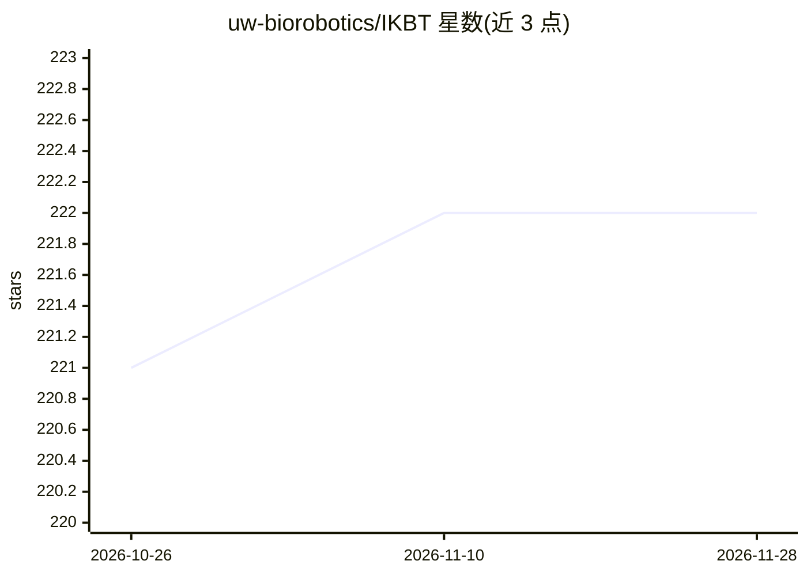

# uw-biorobotics/IKBT

⭐ 222 · Python · NOASSERTION · 推送 2026-11-18 · [GitHub](https://github.com/uw-biorobotics/IKBT) · [官网](https://www.jair.org/index.php/jair/article/view/11592) · 组织维护

**机械臂逆运动学符号求解器：输出闭式/混合解代码**

基于行为树做求解动作选择的 Python 包，为机械臂逆运动学问题生成闭式解；符号解不可得时依次尝试单变量法与混合法（阻尼最小二乘数值精化）。求解结果输出为 LaTeX、Python 与 C++ 三种形式，生成的 C++ 代码经与 Python 结果交叉验证。已在 Puma、C-Arm、Raven-II 三种机械臂上完成闭环验证，验证流程可对任意已解机器人自动运行。

## 筛选速览

| 维度 | 判定 | 备注 |
|---|---|---|
| AI 角色 | `ai-native` | 本体是模型或模型工具 |
| 许可风险 | `none` | NOASSERTION |
| 部署形态 | `None` |  |
| 模型依赖 | — | README 未给出锁定关系 |
| 硬件要求 | — | 无带数字的原话,不猜 |
| 安装摩擦 | `medium` | 含编译或系统依赖之一 |
| 成熟度 | — | 结构信号不足 |

## 能力要点

- 行为树按序尝试符号/单变量/混合三种求解器
- 输出 LaTeX、Python 与 C++ 三种形式代码
- 单变量法：假定一个关节变量已知，其余变量转符号解+1D搜索
- 自动化的闭环验证流程（源自 JAIR 论文的 Puma 验证）

## 适用场景

- 为科研用机械臂推导逆运动学的符号解
- 需要将 IK 解以 Python 或 C++ 代码形式嵌入项目
- 符号解不存在时获取符号+数值混合解

## 场景标签

 · 领域:机器人学/数学求解

## 证据(README 行号)

> L2: A python based system for generating closed-form solutions to the manipulator inverse kinematics problem using
> L3: behavior trees for action selection.

## 星数曲线

2026-10-26 221 → 2026-11-28 222（+1）

---
*卡片 v1 · prompt 1.4 · 生成 2026-11-25 · 置信度 mid · 依据 README sha `7168a64d3f8f` · [字段定义](../../DATASET.md)*
