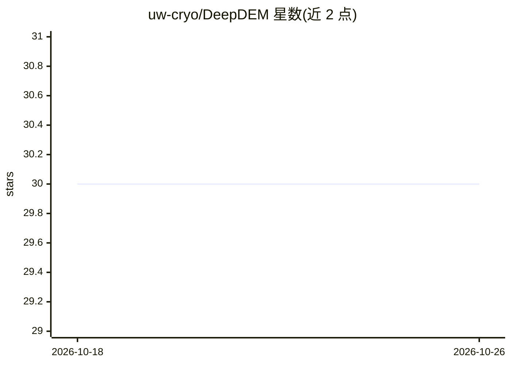

# uw-cryo/DeepDEM

⭐ 30 · Jupyter Notebook · MIT · 推送 2025-11-11 · [GitHub](https://github.com/uw-cryo/DeepDEM) · 组织维护

**深度学习精化立体卫星影像 DSM/DTM 的遥感框架**

由华盛顿大学团队开发的数字高程模型精化框架：以 U-Net + ResNet 编码器网络对立体卫星影像生成的初始 DSM 做残差精化，以机载激光雷达数据为地面真值按 L1 损失训练，也可训练估计稀疏植被下的 DTM。提供编号 Jupyter notebook 工作流（数据预处理、训练、推理）与 Python 脚本，依赖 conda 环境安装，要求用户具备立体摄影测量（ASP）与激光点云（PDAL）处理基础，并自备 Level-1B 立体影像等数据。训练权重计划随论文接收后发布。

## 筛选速览

| 维度 | 判定 | 备注 |
|---|---|---|
| AI 角色 | `ai-native` | 本体是模型或模型工具 |
| 许可风险 | `permissive` | MIT |
| 部署形态 | `None` |  |
| 模型依赖 | — | README 未给出锁定关系 |
| 硬件要求 | — | 无带数字的原话,不猜 |
| 安装摩擦 | `low` | 无编译、无系统依赖或容器化 |
| 成熟度 | — | 结构信号不足 |

## 能力要点

- U-Net + ResNet 编码器对初始 DSM 做残差精化
- 支持 DSM 精化与稀疏植被下 DTM 估计两种训练目标
- 编号 notebook 覆盖预处理、训练、推理全流程，可用任意数据集
- 基于 PyTorch-Lightning、TorchGeo 与 Segmentation Models for PyTorch

## 适用场景

- 精化立体卫星影像生成的数字表面模型
- 从卫星影像与 DSM 推断植被下的数字地形模型
- 用自己的立体影像与激光雷达数据训练新模型

## 场景标签

 · 领域:遥感/地理空间 AI

## 证据(README 行号)

> L5: This repository demonstrates the use of deep learning as an intelligent post-processing filter to refine digital sur
> L7: DeepDEM is a deep learning framework that uses a U-Net architecture with a ResNet encoder to perform residual refine

## 星数曲线

2026-10-18 30 → 2026-10-26 30（+0）

---
*卡片 v1 · prompt 1.4 · 生成 2026-10-26 · 置信度 high · 依据 README sha `228716a7e23a` · [字段定义](../../DATASET.md)*
