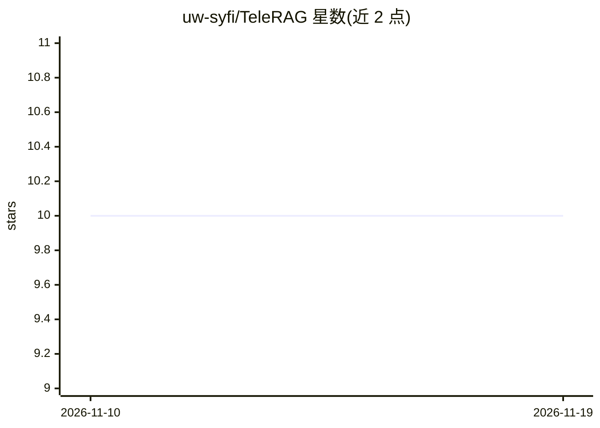

# uw-syfi/TeleRAG

⭐ 10 · Python · Apache-2.0 · 推送 2026-03-31 · [GitHub](https://github.com/uw-syfi/TeleRAG) · [官网](https://arxiv.org/abs/2502.20969) · 组织维护

**面向研究者的 RAG 推理加速系统（lookahead 预取）**

MLSys'26 论文配套的推理系统仓库：核心机制 lookahead retrieval 在 LLM 生成的同时预测所需检索数据并从 CPU 预取到 GPU，配合预取调度器与缓存感知调度器支持多 GPU 推理。仓库包含 ragacc（RAG Acceleration）库的实现，以及覆盖单 GPU 延迟、批量吞吐、nprobe 敏感性与 4/8 GPU 多卡场景的评估脚本，全部实验经 make 目标编排，结果输出至 evaluation/ 与 figure/ 目录。README 未给出安装命令，实验细节指向 docs/artifact-evaluation.md。

## 筛选速览

| 维度 | 判定 | 备注 |
|---|---|---|
| AI 角色 | `ai-native` | 本体是模型或模型工具 |
| 许可风险 | `permissive` | Apache-2.0 |
| 部署形态 | `None` |  |
| 模型依赖 | — | README 未给出锁定关系 |
| 硬件要求 | — | 无带数字的原话,不猜 |
| 安装摩擦 | `low` | 无编译、无系统依赖或容器化 |
| 成熟度 | — | 结构信号不足 |

## 能力要点

- lookahead retrieval：与 LLM 生成并行的 CPU→GPU 预取机制
- 预取调度器与缓存感知调度器支持多 GPU 推理
- ragacc 库实现与论文复现评估脚本（RTX 4090/H100/H200）
- 提供 Artifact Evaluation 文档与引用 BibTeX

## 适用场景

- 复现论文中的 RAG 推理延迟与吞吐实验
- 在多 GPU 环境下测试预取命中率与调度消融
- 在 NQ/HotpotQA/TriviaQA 数据集上对比 FAISS 等检索管线

## 场景标签

`RAG` `推理引擎` · 领域:知识与检索

## 证据(README 行号)

> L8: [TeleRAG][telerag-paper] is an efficient inference system that reduces latency and improves throughput with minimal 
> L12: - TeleRAG's implementation: the `ragacc` library, which stands for RAG Acceleration.
> L55:   journal={arXiv preprint arXiv:2502.20969},

## 星数曲线

2026-11-10 10 → 2026-11-19 10（+0）

---
*卡片 v1 · prompt 1.4 · 生成 2026-11-19 · 置信度 high · 依据 README sha `5258b86bef21` · [字段定义](../../DATASET.md)*
