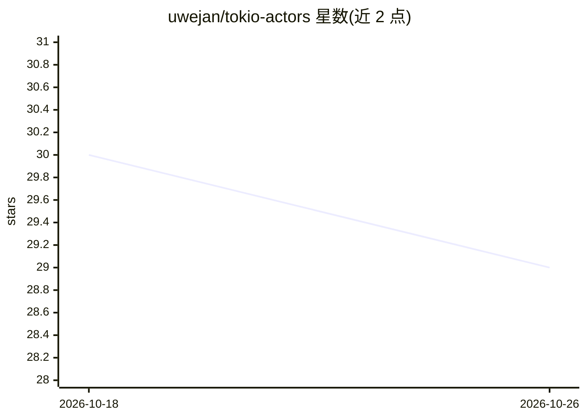

# uwejan/tokio-actors

⭐ 29 · Rust · Apache-2.0 · 推送 2026-10-20 · [GitHub](https://github.com/uwejan/tokio-actors) · [官网](https://docs.rs/tokio-actors) · 个人维护

**Rust 的 Erlang/OTP 语义 actor 运行时，提供监督与崩溃处理**

基于 Tokio 任务的轻量级 actor 框架：每个 actor 是一个专用 tokio::task，无自定义调度器与宏。核心是把 Erlang/OTP 的失败语义移植到 Rust——监督、重启策略（OneForOne/OneForAll/RestForOne/SimpleOneForOne）、重启预算升级、terminate/2 式清理，均对照 gen_server 与 supervisor 文档实现并覆盖测试。给出明确的限制：panic=abort 构建下无进程内监督、非让出忙循环无法中止、无分布层（本地优先，刻意设计）。以 crates.io 包形式提供给 Rust 开发者。

## 筛选速览

| 维度 | 判定 | 备注 |
|---|---|---|
| AI 角色 | `ai-ecosystem` | LLM/agent 周边工具 |
| 许可风险 | `permissive` | Apache-2.0 |
| 部署形态 | `library` | 以包/库形式分发 |
| 模型依赖 | — | README 未给出锁定关系 |
| 硬件要求 | — | 无带数字的原话,不猜 |
| 安装摩擦 | `low` | 无编译、无系统依赖或容器化 |
| 成熟度 | — | 结构信号不足 |

## 能力要点

- 监督/重启/清理语义对照 Erlang/OTP 文档实现，偏离处声明为偏离
- 四种 OTP 重启策略与滑动窗口重启预算升级
- 有界且有据可查的关闭：Shutdown->Kill->task abort 阶梯与 ShutdownReport
- 生命周期契约为运行时强制机制（pre_start/on_started 握手、watch 状态面）

## 适用场景

- 在 Rust 服务中构建具备 let-it-crash 失败处理的 actor 树
- 需要 OTP 式监督重启语义的并发系统
- 构建本地 agent/消息系统的运行时骨架

## 场景标签

`Agent 框架` · 领域:Agent 开发

## 证据(README 行号)

> L9: **The OTP-faithful actor runtime for Rust: supervision, lifecycle, and crash semantics traced to Erlang/OTP, running
> L11: Tokio Actors is a lightweight actor framework for Rust developers who want Erlang-grade failure handling without th

## 星数曲线

2026-10-18 30 → 2026-10-26 29（-1）

---
*卡片 v1 · prompt 1.4 · 生成 2026-10-26 · 置信度 low · 依据 README sha `6595f20e1609` · [字段定义](../../DATASET.md)*
