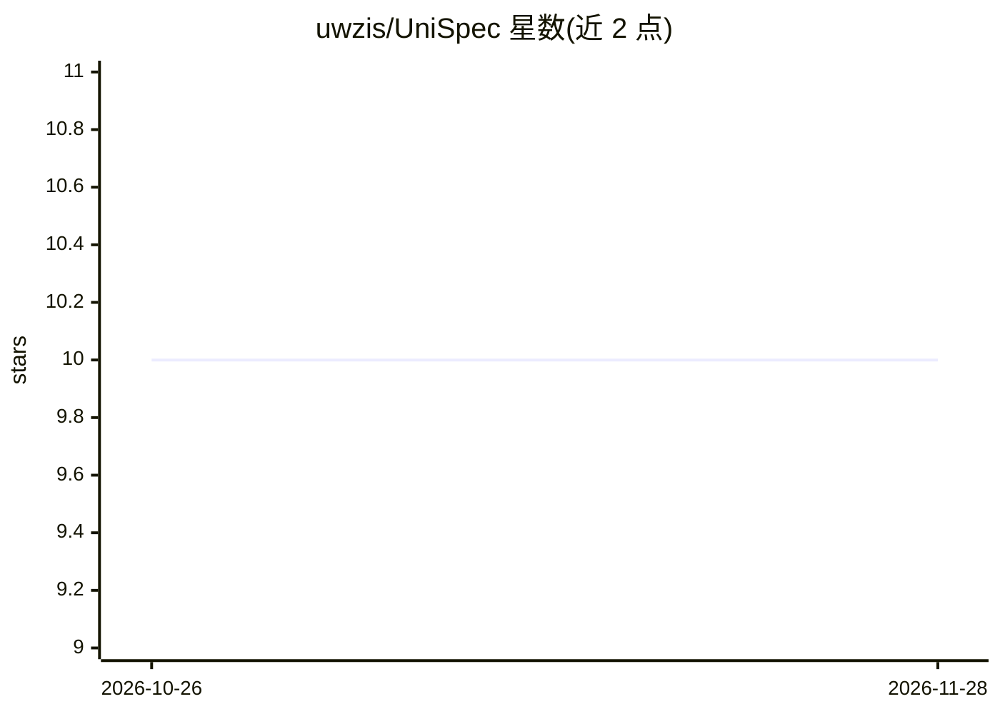

# uwzis/UniSpec

⭐ 10 · Rust · MIT · 推送 2026-05-16 · [GitHub](https://github.com/uwzis/UniSpec) · 个人维护

**给 AI 编码 agent 用的规格驱动开发编排器，类 docker 界面**

用 Rust 编写的开源规格驱动开发（SDD）编排器：以树形规格（Areas/Topics）组织需求与代码索引，提供 Staging/Working/Testing/Fixing/Build 五区流水线与就绪队列门控，通过 `unispec init` 为 24 种 AI 编辑器自动配置，支持社区模式包与自定义工作流，并提供 TUI、CLI 与 MCP 工具文档。安装方式为 git clone 源码，另有 Arch Package 徽标。定位使用 IDE agent 的开发团队与个人。

## 筛选速览

| 维度 | 判定 | 备注 |
|---|---|---|
| AI 角色 | `ai-ecosystem` | LLM/agent 周边工具 |
| 许可风险 | `permissive` | MIT |
| 部署形态 | `None` |  |
| 模型依赖 | — | README 未给出锁定关系 |
| 硬件要求 | — | 无带数字的原话,不猜 |
| 安装摩擦 | `low` | 无编译、无系统依赖或容器化 |
| 成熟度 | — | 结构信号不足 |

## 能力要点

- 树形规格与代码索引（unispec index add）把实现文件挂接到规格主题
- 五区流水线（Staging/Working/Testing/Fixing/Build）与就绪队列门控 push-out
- 一条 init 命令配置 24 种 AI 编辑器集成
- 社区模式包机制（sprint/kanban/RFC/docs）与 shell 命令转 MCP 工具

## 适用场景

- 让 IDE 里的 AI agent 按规格驱动流程写代码
- 大型复杂代码库中保持需求与实现的对应关系
- 团队自定义并复用规格驱动的开发工作流

## 场景标签

`编码 Agent` · 领域:编码与开发

## 证据(README 行号)

> L27: UniSpec is a fully open source spec-driven development orchestrator that allows you to build your own spec-driven w
> L87: UniSpec plays nice with 24 AI editors. When you run `unispec init`, it can set up your editor:

## 星数曲线

2026-10-26 10 → 2026-11-28 10（+0）

---
*卡片 v1 · prompt 1.4 · 生成 2026-11-19 · 置信度 high · 依据 README sha `f2d76173a033` · [字段定义](../../DATASET.md)*
