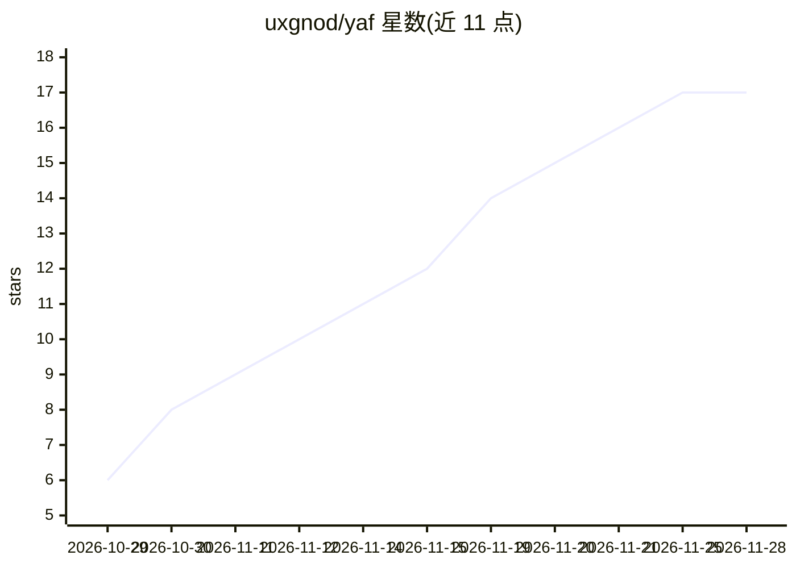

# uxgnod/yaf

⭐ 17 · TypeScript · AGPL-3.0 · 推送 2026-11-18 · [GitHub](https://github.com/uxgnod/yaf) · 个人维护 · 中文 README

**自部署在 Cloudflare 免费套餐上的 flomo 便签替代品，含 AI 语义检索与洞察**

运行于 Cloudflare Workers 单 Worker 的快速记事应用，数据存放在用户自己的 Cloudflare 账户中（D1 + Vectorize，可选 R2）。功能覆盖 Markdown 备忘、嵌套标签、混合检索（D1 FTS5 关键词 + Workers AI bge-m3 语义向量，RRF 合并）、定时洞察报告（每条结论附备忘引用）、MCP 服务器、CLI 与 Markdown/JSON 导出；另支持微信消息捕捉（实验性）。README 标注为 Work in progress，API 可能变动；旧版本 v0.1.0 提供无 AI 的简易版。

## 筛选速览

| 维度 | 判定 | 备注 |
|---|---|---|
| AI 角色 | `ai-native` | 本体是模型或模型工具 |
| 许可风险 | `viral` | AGPL-3.0 |
| 部署形态 | `library` | 以包/库形式分发 |
| 模型依赖 | — | README 未给出锁定关系 |
| 硬件要求 | — | 无带数字的原话,不猜 |
| 安装摩擦 | `low` | 无编译、无系统依赖或容器化 |
| 成熟度 | `idea` | |

## 能力要点

- 混合检索：D1 FTS5 中文分词 + Workers AI bge-m3 语义向量，RRF 合并
- 定时洞察报告，每条结论链接回源备忘
- 内置 MCP 服务器（/mcp），供 AI 助手搜索与写入备忘
- 部署支持让 AI agent 按 AGENT-INSTALL.md 指南完成

## 适用场景

- 自托管部署个人快速记事与标签管理
- 对备忘库做语义搜索并自动汇总周期性主题
- 让 Claude Code 等 AI 助手通过 MCP 直接读写备忘
- 从微信捕获文字、图片与语音转为备忘

## 场景标签

`知识库管理` `语义搜索` · 领域:知识与检索

## 证据(README 行号)

> L5: **yaf is an open-source, self-hosted clone of flomo**, the quick-capture memo app. It runs on Cloudflare, works on t
> L12: - **AI-native**:
> L31: - Hybrid search: keywords (D1 FTS5 + Chinese word segmentation) + semantics (Workers AI `bge-m3` + Vectorize), merg

## 星数曲线

2026-10-29 6 → 2026-11-28 17（+11）

---
*卡片 v1 · prompt 1.4 · 生成 2026-11-18 · 置信度 high · 依据 README sha `89f079694b4c` · [字段定义](../../DATASET.md)*
