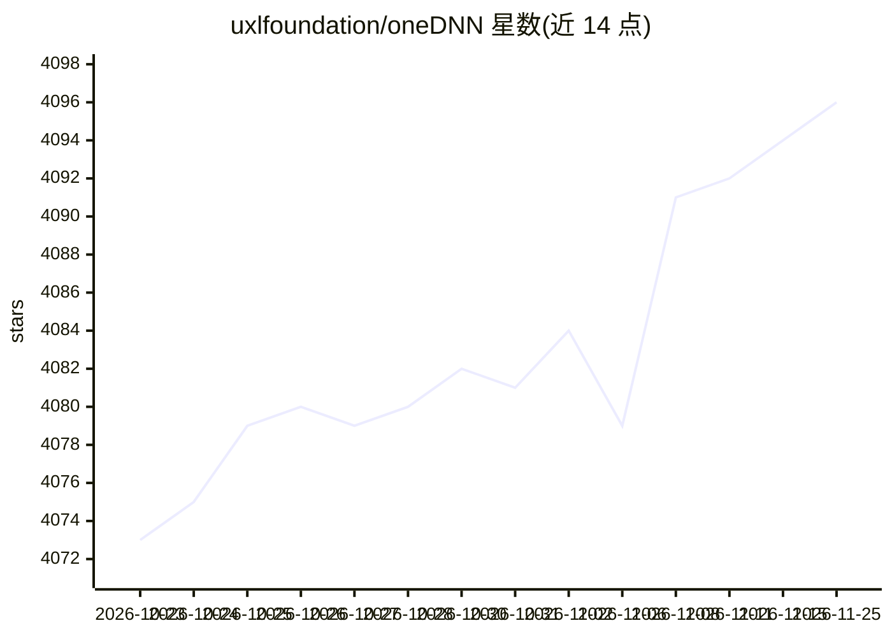

# uxlfoundation/oneDNN

⭐ 4,096 · C++ · Apache-2.0 · 推送 2026-11-24 · [GitHub](https://github.com/uxlfoundation/oneDNN) · [官网](http://uxlfoundation.github.io/oneDNN/) · 组织维护

**为 CPU/GPU 上的深度学习算子提供优化的 C++ 加速库**

oneDNN 是跨平台的深度学习原语库，提供 matmul、卷积、attention、归一化等算子的实现，作为 PyTorch、TensorFlow、OpenVINO 等框架的底层加速层。运行时检测硬件特性并 JIT 生成针对指令集、核心数与缓存大小的内核；支持 f32 至 f4/u4/s4 的低精度数据类型与量化方案，Graph API 可融合 SDPA/GQA 等模式。支持 conda-forge 安装、GitHub 预构建包及源码构建（需 C++11 编译器与 CMake 3.13+）。

## 筛选速览

| 维度 | 判定 | 备注 |
|---|---|---|
| AI 角色 | `ai-native` | 本体是模型或模型工具 |
| 许可风险 | `permissive` | Apache-2.0 |
| 部署形态 | `None` |  |
| 模型依赖 | — | README 未给出锁定关系 |
| 硬件要求 | — | 无带数字的原话,不猜 |
| 安装摩擦 | `high` | 编译与系统依赖俱全 |
| 成熟度 | — | 结构信号不足 |

## 能力要点

- 单一 API 覆盖 Intel 64/AMD64、AArch64、RISC-V CPU 与 Intel GPU
- 运行时检测硬件并 JIT 生成针对指令集的内核
- 支持 f32/bf16/f16/f8/f4/u8/s8/u4/s4 等低精度与量化格式
- Post-ops 融合与 Graph API 融合 SDPA/GQA 模式

## 适用场景

- 为自研推理引擎接入优化的算子实现
- 在 Intel GPU 或 ARM 服务器上运行量化低精度推理
- 为深度学习框架贡献或定制底层算子

## 场景标签

`推理引擎` · 领域:训练与推理

## 证据(README 行号)

> L19: **oneDNN is an open-source, cross-platform library of optimized deep learning
> L22: normalization, and other operations, and is the acceleration layer behind

## 星数曲线

2026-10-23 4,073 → 2026-11-25 4,096（+23）

---
*卡片 v1 · prompt 1.4 · 生成 2026-11-23 · 置信度 high · 依据 README sha `3c1710bb55f6` · [字段定义](../../DATASET.md)*
