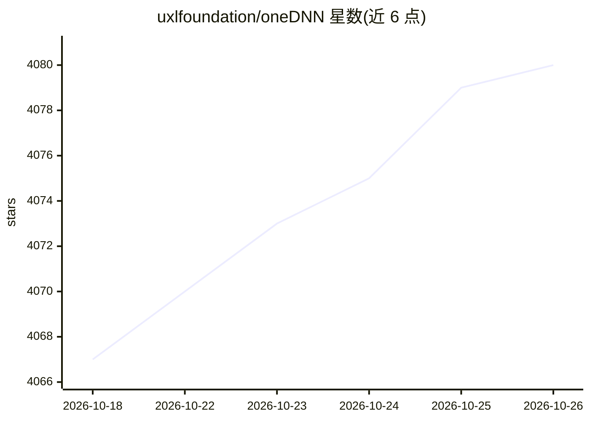

# uxlfoundation/oneDNN

⭐ 4,080 · C++ · Apache-2.0 · 推送 2026-10-25 · [GitHub](https://github.com/uxlfoundation/oneDNN) · [官网](http://uxlfoundation.github.io/oneDNN/) · 组织维护

**面向 CPU 与 GPU 的深度学习算子优化库，供框架做加速层**

oneDNN 是开源跨平台的深度学习算子库，提供矩阵乘、卷积、attention、归一化等运算的优化实现，作为 PyTorch、TensorFlow、OpenVINO、ONNX Runtime、llama.cpp 等框架的加速层。运行时检测硬件特征并 JIT 生成针对指令集、核数与缓存大小特化的内核；支持 f32/bf16/f16/f8 等多种低精度数据类型与算子融合（含 SDPA/GQA）。针对 Intel 64/AMD64、AArch64、RISC-V CPU 与 Intel GPU 优化，NVIDIA/AMD GPU 支持为实验性。可通过 conda-forge 安装或从源码构建，需 C++ 编译器与 CMake 3.13+。README 明确建议深度学习使用者通过上层框架使用而非直接调用。

## 筛选速览

| 维度 | 判定 | 备注 |
|---|---|---|
| AI 角色 | `ai-ecosystem` | LLM/agent 周边工具 |
| 许可风险 | `permissive` | Apache-2.0 |
| 部署形态 | `None` |  |
| 模型依赖 | — | README 未给出锁定关系 |
| 硬件要求 | — | 无带数字的原话,不猜 |
| 安装摩擦 | `high` | 编译与系统依赖俱全 |
| 成熟度 | `idea` | |

## 能力要点

- 同一 API 覆盖 x64/AArch64/RISC-V CPU 与 Intel GPU
- 运行时检测硬件并 JIT 生成针对指令集特化的内核
- 支持 f32/bf16/f16/f8/u8/s8 等低精度数据类型与量化方案
- 算子融合：post-ops 与 Graph API 融合 SDPA/GQA 等模式

## 适用场景

- 为深度学习框架或推理引擎提供 CPU/GPU 算子加速层
- 在多种 CPU 架构上运行低精度量化推理
- 通过 Graph API 融合更大计算模式提升吞吐

## 场景标签

`推理引擎` · 领域:训练与推理

## 证据(README 行号)

> L22: normalization, and other operations, and is the acceleration layer behind
> L23: PyTorch, TensorFlow, OpenVINO, and many other AI frameworks.
> L51: oneDNN is integrated into the following frameworks and applications. Deep

## 星数曲线

2026-10-18 4,067 → 2026-10-26 4,080（+13）

---
*卡片 v1 · prompt 1.4 · 生成 2026-10-20 · 置信度 high · 依据 README sha `4f0af86a51bd` · [字段定义](../../DATASET.md)*
