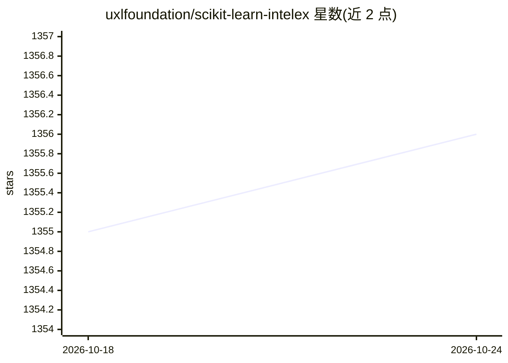

# uxlfoundation/scikit-learn-intelex

⭐ 1,356 · Python · Apache-2.0 · 推送 2026-10-24 · [GitHub](https://github.com/uxlfoundation/scikit-learn-intelex) · [官网](https://uxlfoundation.github.io/scikit-learn-intelex/) · 组织维护

**scikit-learn 加速扩展：为 CPU/GPU 提速训练与推理**

面向 scikit-learn 用户的软件加速扩展，通过 monkeypatching 或 API 兼容模块 sklearnex 无需修改代码即可替换原有调用，底层将算法调用转至 oneDAL（oneAPI Data Analytics Library）。支持 CPU、GPU 及多 GPU 环境，官方基准给出平均 8.5 倍提速且数学精度等价；还可加速预测由 XGBoost 或 LightGBM 生成的决策树模型。以 pip/conda 包形式分发，面向已有 scikit-learn 工作流的开发者和数据科学家。GPU 执行有额外系统软件要求。

## 筛选速览

| 维度 | 判定 | 备注 |
|---|---|---|
| AI 角色 | `ai-ecosystem` | LLM/agent 周边工具 |
| 许可风险 | `permissive` | Apache-2.0 |
| 部署形态 | `library` | 以包/库形式分发 |
| 模型依赖 | — | README 未给出锁定关系 |
| 硬件要求 | — | 无带数字的原话,不猜 |
| 安装摩擦 | `low` | 无编译、无系统依赖或容器化 |
| 成熟度 | — | 结构信号不足 |

## 能力要点

- monkeypatching 或 sklearnex 模块两种接入方式，无需修改现有代码
- 支持 CPU/GPU 及多 GPU 配置
- 底层以 oneDAL 替换 scikit-learn 调用实现加速
- 可加速预测 XGBoost/LightGBM 生成的决策树模型

## 适用场景

- 加速已有 scikit-learn 训练与推理工作流
- 在 GPU 或多节点环境运行 sklearn 算法
- 加速外部决策树模型的预测

## 场景标签

 · 领域:机器学习/数据分析

## 证据(README 行号)

> L18: Extension for scikit-learn is a **free software AI accelerator** designed to deliver up to **100X** acceleration to
> L102: Acceleration in patched scikit-learn classes is achieved by replacing calls to scikit-learn with calls to oneDAL (

## 星数曲线

2026-10-18 1,355 → 2026-10-24 1,356（+1）

---
*卡片 v1 · prompt 1.4 · 生成 2026-10-21 · 置信度 high · 依据 README sha `2ed67bc1ce59` · [字段定义](../../DATASET.md)*
