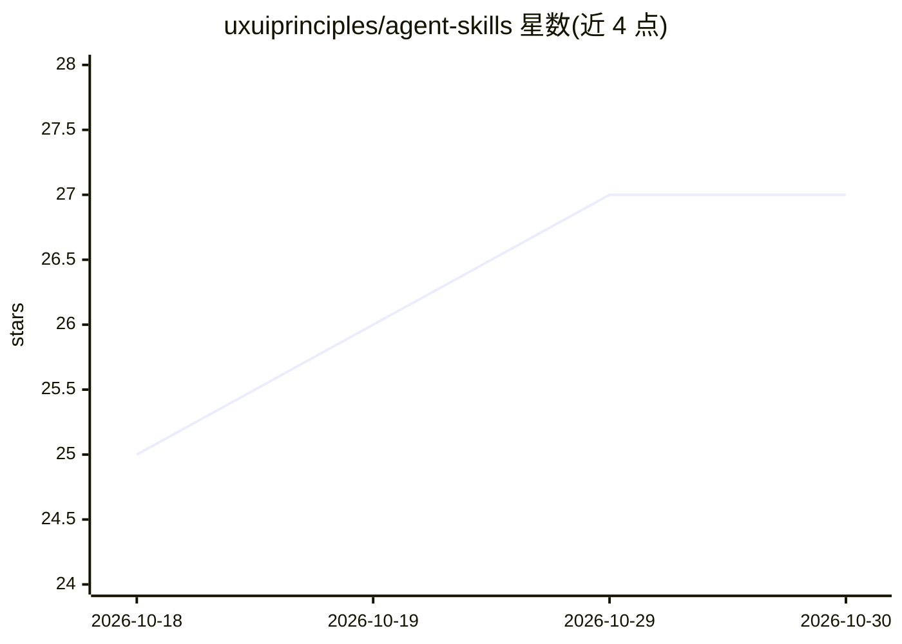

# uxuiprinciples/agent-skills

⭐ 27 · 推送 2026-08-31 · [GitHub](https://github.com/uxuiprinciples/agent-skills) · [官网](https://uxuiprinciples.com) · 组织维护

**给 AI agent 注入 UX 专业能力的五个 SKILL.md 技能文件**

由 uxuiprinciples.com 维护的 agent 技能包：五个 SKILL.md 文件分别做界面评估（195 条研究原则）、UX 反模式检测、AI/LLM 界面审查（61 条原则）、流程检查与编码会话 UX 上下文注入，兼容 Cursor、Windsurf、kx、Claude Code 及任何读取 SKILL.md 的框架。技能仅依赖 LLM 推理即可运行；配置 UXUI_API_KEY（付费计划，$19/年起）可解锁原则编码、2,300+ 学术引用、严重度分级与修复方案等增强输出。flow-checker 需 API key。安装方式为复制 SKILL.md 到项目根目录。

## 筛选速览

| 维度 | 判定 | 备注 |
|---|---|---|
| AI 角色 | `ai-knowledge` | 知识聚合/清单类 |
| 许可风险 | `none` | — |
| 部署形态 | `None` |  |
| 模型依赖 | — | README 未给出锁定关系 |
| 硬件要求 | — | 无带数字的原话,不猜 |
| 安装摩擦 | `low` | 无编译、无系统依赖或容器化 |
| 成熟度 | — | 结构信号不足 |

## 能力要点

- 五个 SKILL.md 技能：评估/反模式检测/AI 界面审查/流程检查/编码上下文注入
- 无 API key 也可用 LLM 推理运行（flow-checker 除外）
- API key 解锁 195 条原则编码、2,300+ 学术引用与修复方案
- 兼容任何读取 SKILL.md 的 agent 框架

## 适用场景

- 让 Cursor/Claude Code 等编码 agent 在生成组件时带上 UX 上下文
- 对现有界面做基于研究原则的 UX 评估与反模式检测
- 审查 AI/LLM 产品的界面设计

## 场景标签

`提示工程` · 领域:Agent 开发

## 证据(README 行号)

> L7: Five SKILL.md files that inject UX expertise into AI agents. Works with Cursor, Windsurf, kx, Claude Code, and any f
> L15: |Skill|Description|API Required|
> L62: The skills reference the uxuiprinciples 6-part taxonomy:

## 星数曲线

2026-10-18 25 → 2026-10-30 27（+2）

---
*卡片 v1 · prompt 1.4 · 生成 2026-10-26 · 置信度 high · 依据 README sha `21eb11b29dd5` · [字段定义](../../DATASET.md)*
