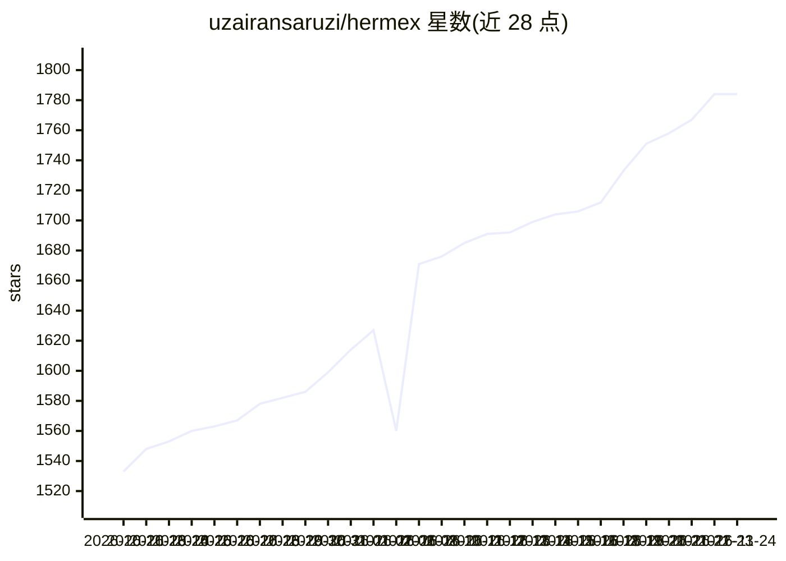

# uzairansaruzi/hermex

⭐ 1,812 · Swift · MIT · 推送 2026-11-23 · [GitHub](https://github.com/uzairansaruzi/hermex) · [官网](https://hermexapp.com/) · 个人维护

**连接自托管 Hermes Agent 的原生成 iOS 客户端**

Hermex 是一款 Swift/SwiftUI 编写的 iPhone/iPad 原生应用，作为自托管 Hermes Agent 服务器的客户端：从手机启动与引导会话、流式查看 agent 思考与工具调用、回复审批提问、审阅文件改动并执行 Git 暂存/提交/推送。支持语音输入与播报、会话管理、Bots 一对一及群聊、定时任务与看板、多服务器切换。应用本身免费、无内购；不含服务器端，用户需自行安装并暴露 Hermes Agent（0.21.3+）。

## 筛选速览

| 维度 | 判定 | 备注 |
|---|---|---|
| AI 角色 | `ai-ecosystem` | LLM/agent 周边工具 |
| 许可风险 | `permissive` | MIT |
| 部署形态 | `None` |  |
| 模型依赖 | — | README 未给出锁定关系 |
| 硬件要求 | — | 无带数字的原话,不猜 |
| 安装摩擦 | `medium` | 含编译或系统依赖之一 |
| 成熟度 | — | 结构信号不足 |

## 能力要点

- 原生 SwiftUI 应用，非 Web 封装，要求 iOS/iPadOS 18+
- 流式对话、审批应答、HTML 报告内嵌渲染与 Git 操作
- 语音输入输出依赖主机端 speech-to-text 与 voice
- 推送通知经可自托管的开源 relay，不上传消息文本

## 适用场景

- 在手机上远程引导和监控自托管 agent 的工作会话
- 移动端审阅并提交 agent 的代码改动
- 通过定时任务和看板管理 agent 的长期工作

## 场景标签

`编码 Agent` `聊天机器人` · 领域:编码与开发

## 证据(README 行号)

> L26: Hermex is a native SwiftUI app for iPhone and iPad. It connects directly to a Hermes Agent host that you run. From 
> L49: Hermex is a client only. It doesn't ship, host, or provision a server. You run Hermes Agent on a machine you contro

## 星数曲线

2026-10-21 1,533 → 2026-11-24 1,784（+251）

---
*卡片 v1 · prompt 1.4 · 生成 2026-11-23 · 置信度 high · 依据 README sha `e46dbd8fbc69` · [字段定义](../../DATASET.md)*
