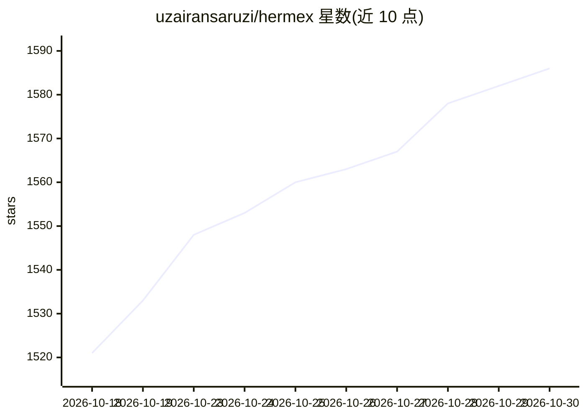

# uzairansaruzi/hermex

⭐ 1,586 · Swift · MIT · 推送 2026-10-29 · [GitHub](https://github.com/uzairansaruzi/hermex) · [官网](https://hermexapp.com/) · 个人维护

**从 iPhone 控制自托管 Hermes agent 的原生 SwiftUI 客户端**

面向自建 hermes-webui 服务器用户的原生 iOS 应用（SwiftUI，iOS 18+）：手机作为控制平面连接用户自己的服务器，提供流式聊天、会话浏览与恢复、模型切换、定时任务管理、技能浏览、服务器文件浏览与内存/用量面板。应用本身不含后端，需用户自行部署服务器并通过 HTTPS 隧道、Tailscale 或局域网接入。免费无订阅，推送通知默认关闭且可自托管中继。App Store 提供下载，也可用 Xcode 从源码构建。

## 筛选速览

| 维度 | 判定 | 备注 |
|---|---|---|
| AI 角色 | `ai-ecosystem` | LLM/agent 周边工具 |
| 许可风险 | `permissive` | MIT |
| 部署形态 | `None` |  |
| 模型依赖 | — | README 未给出锁定关系 |
| 硬件要求 | — | 无带数字的原话,不猜 |
| 安装摩擦 | `medium` | 含编译或系统依赖之一 |
| 成熟度 | — | 结构信号不足 |

## 能力要点

- 流式聊天，支持模型/推理力度/工作区选项与文件图片附件
- 会话管理、定时任务编辑、技能浏览、服务器文件浏览
- 仅连接用户自有服务器，无分析无追踪，推送中继可自托管
- 兼容 hermes-webui 固定测试 commit，对未知字段容错解码

## 适用场景

- 在外出时用手机操控家里服务器上运行的 AI agent
- 查看和恢复历史会话、管理 agent 定时任务与技能
- 通过 Tailscale 等私有网络安全访问自托管 agent

## 场景标签

`聊天机器人` · 领域:对话与助手

## 证据(README 行号)

> L23: Hermex is a native SwiftUI iPhone app for driving a self-hosted hermes-webui server — a mobile cockpit for an AI ag
> L49: Hermex is a client only — it does not ship with, host, or provision a backend. You bring your own hermes-webui serv

## 星数曲线

2026-10-18 1,521 → 2026-10-30 1,586（+65）

---
*卡片 v1 · prompt 1.4 · 生成 2026-10-21 · 置信度 high · 依据 README sha `ac6e62c9b3ce` · [字段定义](../../DATASET.md)*
