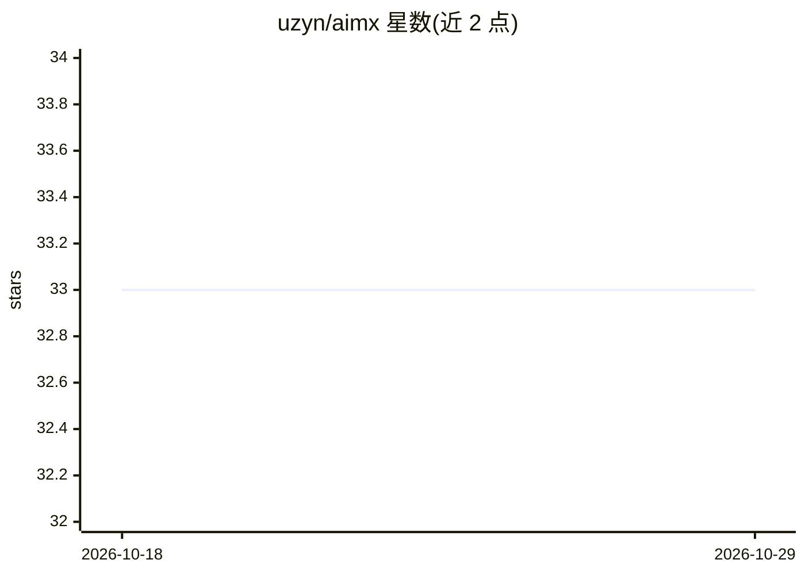

# uzyn/aimx

⭐ 33 · Rust · MIT · 推送 2026-10-24 · [GitHub](https://github.com/uzyn/aimx) · [官网](https://aimx.email) · 个人维护

**给 AI agent 用的自托管 SMTP 邮件服务器与 MCP stdio 服务**

AIMX 是单一二进制的 Linux 自托管邮件服务器（SMTP），同时内置 MCP stdio server，让 AI agent 拥有自己的邮箱地址并通过 MCP 工具收发邮件。邮件以 Markdown+TOML frontmatter 落盘，无需 MIME 解析；支持 MTA 直投、on_receive/after_send 钩子、DKIM/SPF/DMARC 信任门控（不可信邮件不触发钩子以降低提示注入风险）。一条命令接入 Claude Code、Codex CLI、Gemini CLI、Goose 等 harness。设计限制：单操作者单域名，无 IMAP/POP3/Webmail/SMTP AUTH/重试队列/退信，需开放 25 端口的自有域名服务器。

## 筛选速览

| 维度 | 判定 | 备注 |
|---|---|---|
| AI 角色 | `ai-ecosystem` | LLM/agent 周边工具 |
| 许可风险 | `permissive` | MIT |
| 部署形态 | `None` |  |
| 模型依赖 | — | README 未给出锁定关系 |
| 硬件要求 | — | 无带数字的原话,不猜 |
| 安装摩擦 | `medium` | 含编译或系统依赖之一 |
| 成熟度 | — | 结构信号不足 |

## 能力要点

- Markdown+TOML frontmatter 落盘存储，附件为普通文件，无需 MIME 解析
- 内置 MCP stdio server，提供 email_send/email_list 等 9 个 MCP 工具
- DKIM 门控钩子：仅通过验证并匹配 allowlist 的邮件可触发自动化
- 单二进制 + 引导式安装脚本，一条命令为多家 agent harness 配好 MCP

## 适用场景

- 给财务 agent、客服 agent 等分配独立邮箱并自动处理来信
- 隐私敏感邮件（账单、医疗、法律）不经第三方服务器收发
- 两个 agent 之间用 DKIM 签名邮件作为跨机消息通道
- 邮件到达即触发钩子做监控告警与自愈

## 场景标签

 · 领域:AI agent 基础设施/邮件

## 证据(README 行号)

> L21: AIMX (AI Mail Exchange) is a self-hosted email server (SMTP) and MCP stdio server that gives AI agents their own em
> L32: * **Built-in MCP server.** Stdio MCP. Efficient. MCP server only runs on demand, kills off when done.

## 星数曲线

2026-10-18 33 → 2026-10-29 33（+0）

---
*卡片 v1 · prompt 1.4 · 生成 2026-10-26 · 置信度 high · 依据 README sha `b3ec0b4f1711` · [字段定义](../../DATASET.md)*
