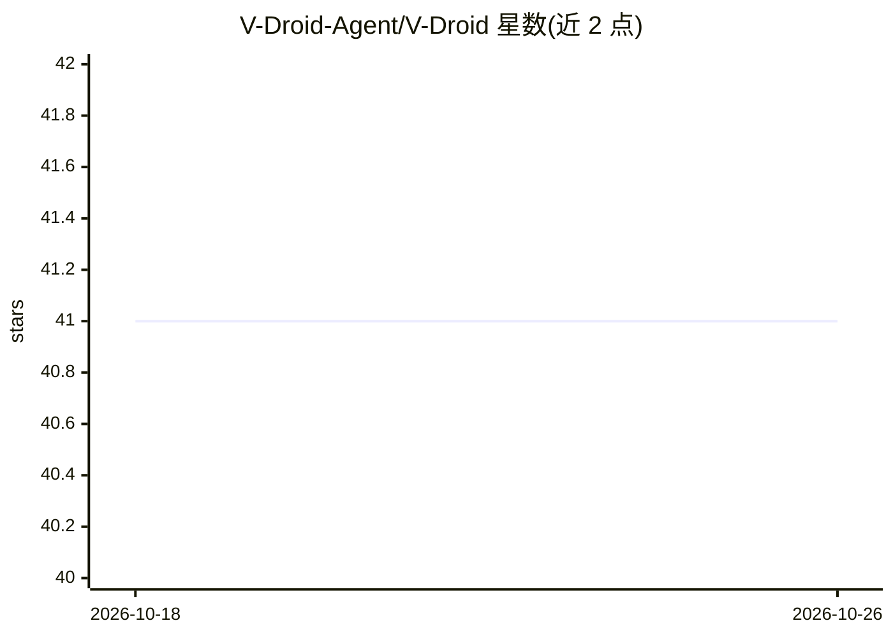

# V-Droid-Agent/V-Droid

⭐ 41 · Python · 推送 2026-02-02 · [GitHub](https://github.com/V-Droid-Agent/V-Droid) · [官网](https://arxiv.org/abs/2503.15937) · 组织维护

**用 LLM 做验证器的移动 GUI agent 论文代码**

MobiCom'26 论文 V-Droid 的公开源码：不同于用 LLM 直接生成动作的移动 agent，V-Droid 用 LLM 作为验证器对候选动作打分后再决策。流程为从 UI 抽取动作、构建验证 prompt、批量打分（前缀缓存）、执行选中动作并更新工作记忆。提供 8B 模型 LoRA 权重（Hugging Face），基于 AndroidWorld 模拟器环境运行评测，并附训练脚本。需修改 vLLM 源码，模型 API 仅用于构建工作记忆且可不用。

## 筛选速览

| 维度 | 判定 | 备注 |
|---|---|---|
| AI 角色 | `ai-native` | 本体是模型或模型工具 |
| 许可风险 | `none` | — |
| 部署形态 | `library` | 以包/库形式分发 |
| 模型依赖 | local-ok | 支持本地模型 |
| 硬件要求 | — | 无带数字的原话,不猜 |
| 安装摩擦 | `medium` | 含编译或系统依赖之一 |
| 成熟度 | `idea` | |

## 能力要点

- LLM-as-verifier 范式：候选动作批量打分后执行
- 提供 LoRA 权重与训练脚本（train.sh）
- 在 AndroidWorld/AndroidLab/MobileAgentBench 上评测，单步延迟 0.7 秒

## 适用场景

- 复现论文中验证器驱动的移动 GUI agent 实验
- 在 Android 模拟器上跑移动任务自动化评测
- 基于提供的训练对微调自己的验证器

## 场景标签

`GUI 自动化` `科研工具` · 领域:效率与自动化

## 证据(README 行号)

> L3: This repo provides the public preview for **V-Droid**(https://arxiv.org/abs/2503.15937), a verifier-driven mobile GU
> L21:  3) Scoring with the verifier in batch with prefix caching;

## 星数曲线

2026-10-18 41 → 2026-10-26 41（+0）

---
*卡片 v1 · prompt 1.4 · 生成 2026-10-25 · 置信度 mid · 依据 README sha `1ed98dc13c59` · [字段定义](../../DATASET.md)*
