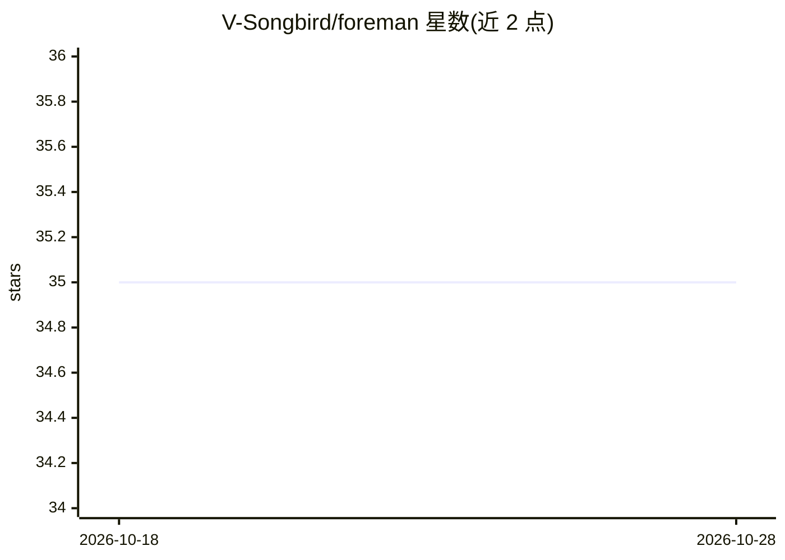

# V-Songbird/foreman

⭐ 35 · JavaScript · MIT · 推送 2026-10-22 · [GitHub](https://github.com/V-Songbird/foreman) · [官网](https://github.com/V-Songbird/foundry) · 个人维护

**给单人开发者的项目连续性插件：代码旁的任务路线图**

面向 Claude Code、Codex 与 Antigravity 三种 AI 编程助手的插件：在项目内维护一个 ROADMAP.jsonl 路线图，记录任务、理由与边界；回答"what's next?"时给出推荐任务及其理由，并生成对照项目文件检查过的交接 prompt。完成后将证据写回计划，验收与测试通过保持分离。声明仅供单人开发者使用，不做团队追踪或工作流服务器；三个宿主间可复用同一份路线图数据，但功能因宿主事件能力而异（如 Antigravity 无 taskCloseGate）。

## 筛选速览

| 维度 | 判定 | 备注 |
|---|---|---|
| AI 角色 | `ai-ecosystem` | LLM/agent 周边工具 |
| 许可风险 | `permissive` | MIT |
| 部署形态 | `None` |  |
| 模型依赖 | — | README 未给出锁定关系 |
| 硬件要求 | — | 无带数字的原话,不猜 |
| 安装摩擦 | `low` | 无编译、无系统依赖或容器化 |
| 成熟度 | — | 结构信号不足 |

## 能力要点

- 路线图存于项目内（ROADMAP.jsonl 与 .foreman/ 文件），三个宿主共用
- what's next 推荐任务并附理由与对照项目文件的 prompt
- 任务 id 贯穿路线图、决策记录、代码锚点与 git 提交
- 阻止直接编辑路线图文件的宿主工具各不相同

## 适用场景

- 跨会话接续上次未完成的开发任务
- 把散落的请求整理成带理由与边界的任务清单
- 在开工前核对计划是否仍与代码一致

## 场景标签

 · 领域:开发工具/AI 编程助手

## 证据(README 行号)

> L16: You finish a session with a fix, a side request and an issue still waiting. Next time, you need to know which one c
> L57: Foreman is one plugin for the three assistants. Install it in the one you use; only the commands differ.
> L106: Foreman is for a solo developer. It does not become a team tracker, code-review service, unattended scheduler or w

## 星数曲线

2026-10-18 35 → 2026-10-28 35（+0）

---
*卡片 v1 · prompt 1.4 · 生成 2026-10-25 · 置信度 high · 依据 README sha `2ec246343d76` · [字段定义](../../DATASET.md)*
