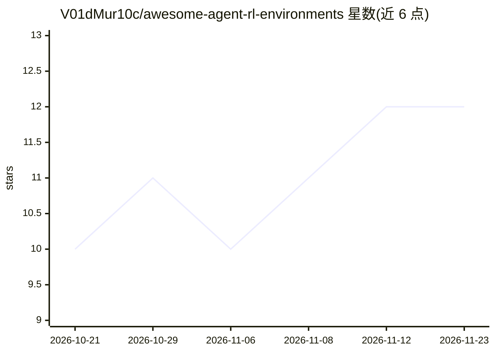

# V01dMur10c/awesome-agent-rl-environments

⭐ 12 · CC0-1.0 · 推送 2026-11-17 · [GitHub](https://github.com/V01dMur10c/awesome-agent-rl-environments) · 个人维护

**LLM/VLM 智能体训练与评估环境策展清单（周更）**

面向训练、评估或构建 LLM 智能体的开发者与研究者，收录多轮强化学习时代的"智能体 Gym"类项目：GEM、RAGEN、AgentGym、SWE-Gym、WebArena、OSWorld 等。收录标准为满足交互环境、RL 训练设计或 gym 式统一 API 三者之一，排除经典 RL 基准与单轮评测榜单。按编程、Web 浏览器、操作系统/移动端、工具调用、科研五类组织，每条附已验证的 GitHub 链接与论文链接，每周更新。

## 筛选速览

| 维度 | 判定 | 备注 |
|---|---|---|
| AI 角色 | `ai-knowledge` | 知识聚合/清单类 |
| 许可风险 | `viral` | CC0-1.0 |
| 部署形态 | `None` |  |
| 模型依赖 | — | README 未给出锁定关系 |
| 硬件要求 | — | 无带数字的原话,不猜 |
| 安装摩擦 | `low` | 无编译、无系统依赖或容器化 |
| 成熟度 | — | 结构信号不足 |

## 能力要点

- 收录标准明确：交互环境、RL 训练设计、gym 式统一 API 三者满足其一
- 按编码、Web、OS/移动、工具、科研五类组织条目
- 每条附已验证 GitHub 链接与论文链接
- 提供框架速查表（RL 算法、原生环境、仓库对照）

## 适用场景

- 为多轮 RL 训练 LLM 智能体挑选环境框架
- 查找浏览器/桌面/工具调用类智能体的评测基准
- 跟踪智能体强化学习领域新项目的更新

## 场景标签

`精选清单` `模型评测` `强化学习` · 领域:评测与运维

## 证据(README 行号)

> L3: > A curated list of **training and evaluation environments for LLM / VLM agents**, with a focus on the era of multi-
> L7: **Scope.** We only include projects that satisfy at least one of:
> L15: **Every entry below has a verified GitHub link.** PRs that add a missing project, fix a broken link, or report a be

## 星数曲线

2026-10-21 10 → 2026-11-23 12（+2）

---
*卡片 v1 · prompt 1.4 · 生成 2026-11-18 · 置信度 high · 依据 README sha `e0be96661ddb` · [字段定义](../../DATASET.md)*
