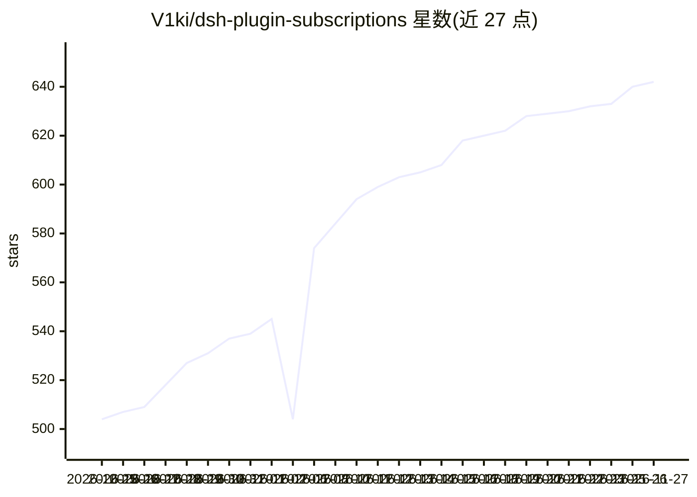

# V1ki/dsh-plugin-subscriptions

⭐ 642 · TypeScript · MIT · 推送 2026-11-25 · [GitHub](https://github.com/V1ki/dsh-plugin-subscriptions) · 个人维护 · 中文 README

**DSH 插件：将 ChatGPT/Claude/Grok 等订阅账号转为 LLM 接入通道**

DeepSeek Harness（DSH）的订阅接入插件：把用户的 ChatGPT (Codex)、Claude、Grok (X Premium)、GitHub Copilot、Google Antigravity 订阅作为 LLM provider 接入，通过 web UI 的 OAuth 登录或导入已有 Claude Code 会话凭据，无需 API key；令牌存于本地并自动刷新。提供订阅/模型显示名管理、模型与 reasoning effort 选择、配额状态栏与用量仪表盘（26 周热力图、周期图表）、图像/视频生成工具内联展示等功能。

## 筛选速览

| 维度 | 判定 | 备注 |
|---|---|---|
| AI 角色 | `ai-ecosystem` | LLM/agent 周边工具 |
| 许可风险 | `permissive` | MIT |
| 部署形态 | `library` | 以包/库形式分发 |
| 模型依赖 | locked-api |  |
| 硬件要求 | — | 无带数字的原话,不猜 |
| 安装摩擦 | `low` | 无编译、无系统依赖或容器化 |
| 成熟度 | — | 结构信号不足 |

## 能力要点

- OAuth 登录订阅账号作为 LLM provider，无需 API key
- 配额用量 pill 与 Usage Dashboard（KPI、26 周热力图、周期图表）
- image_generate / video_generate 工具结果内联渲染
- 订阅与模型显示名自定义，持久化存储

## 适用场景

- 在 DSH 中用已有的 ChatGPT/Claude/Grok 订阅驱动会话
- 集中查看各订阅账号的配额与 token 用量历史
- 在同一会话中选择不同订阅来源的模型与推理档位

## 场景标签

`模型网关` · 领域:Agent 开发

## 证据(README 行号)

> L5: Use your **ChatGPT (Codex)**, **Claude**, **Grok (X Premium)**, **GitHub Copilot**, and **Google Antigravity** subsc
> L75: Open **Subscriptions** from the DSH sidebar to view the unified page with **Usage** (default) and **Settings** tabs

## 星数曲线

2026-10-25 504 → 2026-11-27 642（+138）

---
*卡片 v1 · prompt 1.4 · 生成 2026-11-26 · 置信度 high · 依据 README sha `12e669066806` · [字段定义](../../DATASET.md)*
