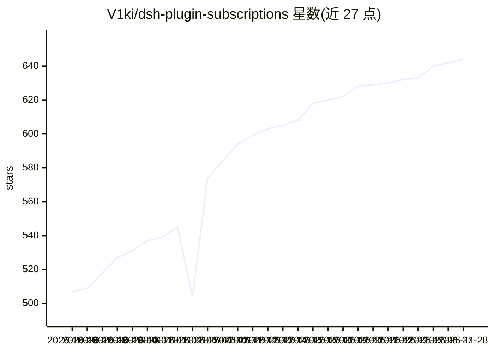

# V1ki/dsh-plugin-subscriptions

⭐ 644 · TypeScript · MIT · 推送 2026-11-27 · [GitHub](https://github.com/V1ki/dsh-plugin-subscriptions) · 个人维护

**把 ChatGPT/Claude/Grok 等订阅接入 DSH 的插件，免 API key**

DeepSeek Harness（DSH）的插件，将用户的 ChatGPT (Codex)、Claude、Grok (X Premium)、GitHub Copilot、Google Antigravity 订阅转为 LLM provider：通过 Web UI 浏览器 OAuth 或凭证导入登录，凭据本地存储并自动刷新。提供实时模型目录、多账户池与 429 限流处理、按 provider 内置工具（web_search/x_search/image_generate/video_generate），以及用量仪表盘（26 周热力图、配额周期图表）。要求 DSH >=0.2.0-rc.2；Google Antigravity 因封号风险默认禁用。

## 筛选速览

| 维度 | 判定 | 备注 |
|---|---|---|
| AI 角色 | `ai-ecosystem` | LLM/agent 周边工具 |
| 许可风险 | `permissive` | MIT |
| 部署形态 | `library` | 以包/库形式分发 |
| 模型依赖 | locked-api |  |
| 硬件要求 | — | 无带数字的原话,不猜 |
| 安装摩擦 | `low` | 无编译、无系统依赖或容器化 |
| 成熟度 | — | 结构信号不足 |

## 能力要点

- 五个订阅 provider，通过浏览器 OAuth/设备流登录，无需 API key
- 多账户池与按 provider 自动故障切换、429 窗口等待
- 内置 Codex web_search、Grok x_search、GPT/Grok image_generate 与 video_generate 工具
- 用量仪表盘：26 周热力图、token 趋势与配额周期图表

## 适用场景

- 用已有的 ChatGPT/Claude/Grok 订阅在 DSH 会话中调用模型
- 为多个订阅账户配置故障切换与配额监控
- 在对话中使用订阅内的图像/视频生成与 X 搜索工具

## 场景标签

`模型网关` · 领域:Agent 开发

## 证据(README 行号)

> L5: Use your **ChatGPT (Codex)**, **Claude**, **Grok (X Premium)**, **GitHub Copilot**, and **Google Antigravity** subsc
> L95: > **DSH compatibility:** Requires DSH `>=0.2.0-rc.2` (DSH `0.1.x` is no longer supported). See Development & DSH co

## 星数曲线

2026-10-26 507 → 2026-11-28 644（+137）

---
*卡片 v1 · prompt 1.4 · 生成 2026-11-28 · 置信度 high · 依据 README sha `c889958bdced` · [字段定义](../../DATASET.md)*
