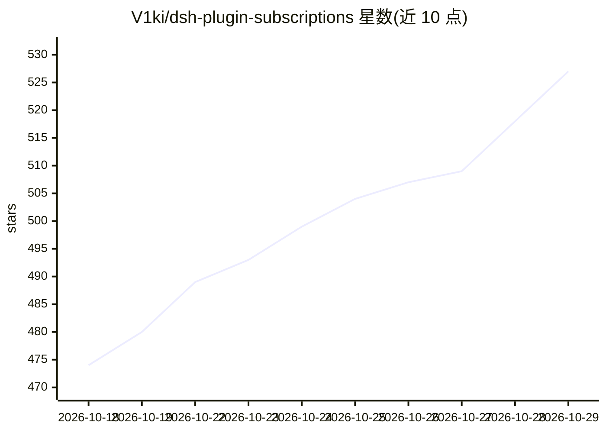

# V1ki/dsh-plugin-subscriptions

⭐ 527 · TypeScript · MIT · 推送 2026-10-26 · [GitHub](https://github.com/V1ki/dsh-plugin-subscriptions) · 个人维护 · 中文 README

**DSH 插件：用 ChatGPT/Claude/Grok 等订阅作为 LLM 提供方，免 API key**

DeepSeek Harness（DSH）的 TypeScript 插件，把 ChatGPT (Codex)、Claude、Grok (X Premium)、GitHub Copilot、Google Antigravity 订阅账号接入为 LLM 提供方：Codex/Grok/Antigravity 走 dsh Web UI 的 OAuth 登录，Copilot 用 OAuth 设备流，Claude 可从已有 Claude Code 会话导入凭据。令牌存于 ~/.dsh 并自动刷新。附带 web_search、x_search、image_generate、video_generate 工具，展示各订阅的用量与限额窗口。限定兼容 DSH 0.2.0-rc.2 至 0.2.1-rc.2 的特定版本。

## 筛选速览

| 维度 | 判定 | 备注 |
|---|---|---|
| AI 角色 | `ai-ecosystem` | LLM/agent 周边工具 |
| 许可风险 | `permissive` | MIT |
| 部署形态 | `library` | 以包/库形式分发 |
| 模型依赖 | — | README 未给出锁定关系 |
| 硬件要求 | — | 无带数字的原话,不猜 |
| 安装摩擦 | `low` | 无编译、无系统依赖或容器化 |
| 成熟度 | — | 结构信号不足 |

## 能力要点

- 5 种订阅服务经 OAuth 登录接入为 LLM 提供方，无需 API key
- Claude 可从本机 Claude Code 会话导入凭据（Keychain 或 credentials.json）
- 内置 image_generate/video_generate/web_search/x_search 工具，图像与视频在会话内联展示
- 按订阅展示 5 小时/每周等限额窗口的用量百分比与重置时间

## 适用场景

- 用已有 ChatGPT/Claude/Grok 订阅在 DSH 中跑模型，不想另买 API key
- 在会话内直接生成与编辑图片、生成短视频
- 跟踪各订阅账号的配额用量与重置时间

## 场景标签

`模型网关` `图像生成` `视频生成` · 领域:Agent 开发

## 证据(README 行号)

> L5: Use your **ChatGPT (Codex)**, **Claude**, **Grok (X Premium)**, **GitHub Copilot**, and **Google Antigravity** subsc
> L61: |Route|Subscription|Models|

## 星数曲线

2026-10-18 474 → 2026-10-29 527（+53）

---
*卡片 v1 · prompt 1.4 · 生成 2026-10-21 · 置信度 high · 依据 README sha `cfac77c4bf6c` · [字段定义](../../DATASET.md)*
