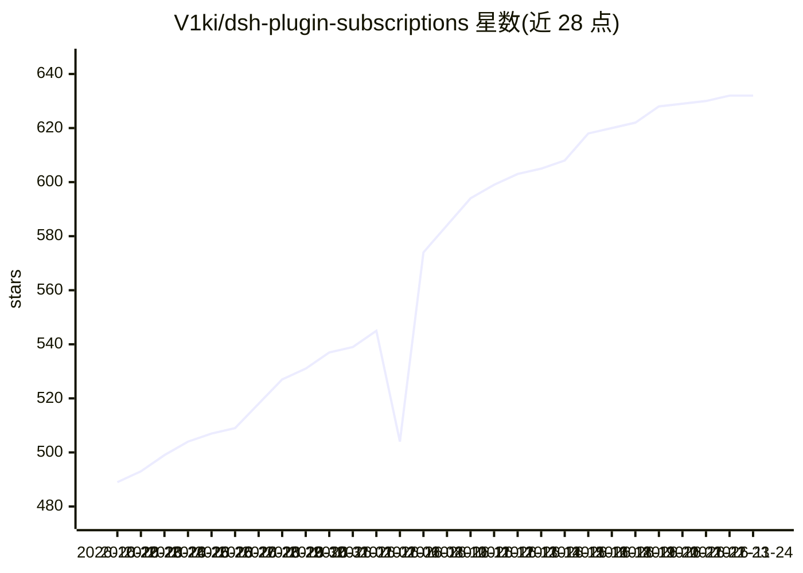

# V1ki/dsh-plugin-subscriptions

⭐ 632 · TypeScript · MIT · 推送 2026-11-21 · [GitHub](https://github.com/V1ki/dsh-plugin-subscriptions) · 个人维护

**将 ChatGPT/Claude/Grok 订阅接入 DeepSeek Harness 的插件**

DeepSeek Harness 的订阅插件：通过 OAuth 登录把 ChatGPT (Codex)、Claude、Grok (X Premium)、GitHub Copilot、Google Antigravity 五类订阅转成 LLM provider，无需 API key。提供 web UI 内登录、模型目录同步、推理力度/速度档选择、图像与视频生成工具内联渲染，以及订阅用量配额展示（5 小时/每周窗口、进度条、重置时间）。Token 存于本地 auth.json（0600）并自动刷新；Claude 凭据可从已有 Claude Code 会话导入，否则走浏览器 OAuth。

## 筛选速览

| 维度 | 判定 | 备注 |
|---|---|---|
| AI 角色 | `ai-ecosystem` | LLM/agent 周边工具 |
| 许可风险 | `permissive` | MIT |
| 部署形态 | `library` | 以包/库形式分发 |
| 模型依赖 | locked-api |  |
| 硬件要求 | — | 无带数字的原话,不猜 |
| 安装摩擦 | `low` | 无编译、无系统依赖或容器化 |
| 成熟度 | — | 结构信号不足 |

## 能力要点

- 五类订阅源 OAuth 登录接入，无需 API key
- 每 provider 的用量配额展示（5 小时/每周窗口与重置时间）
- 推理力度 Effort 选择器与 Codex Fast 档切换
- image_generate/video_generate 工具按 provider 内联渲染结果

## 适用场景

- 在 DeepSeek Harness 中用已有订阅账号调用各家模型
- 多订阅账号下查看各 provider 的配额与限流窗口
- 不写 API key 的团队接入订阅制模型

## 场景标签

`模型网关` · 领域:Agent 开发

## 证据(README 行号)

> L5: Use your **ChatGPT (Codex)**, **Claude**, **Grok (X Premium)**, **GitHub Copilot**, and **Google Antigravity** subsc
> L73: ## Providers
> L83: Only logged-in providers appear in the session model picker; the lists above refresh on login/logout. Vision-capabl

## 星数曲线

2026-10-22 489 → 2026-11-24 632（+143）

---
*卡片 v1 · prompt 1.4 · 生成 2026-11-24 · 置信度 high · 依据 README sha `fc80b8450058` · [字段定义](../../DATASET.md)*
