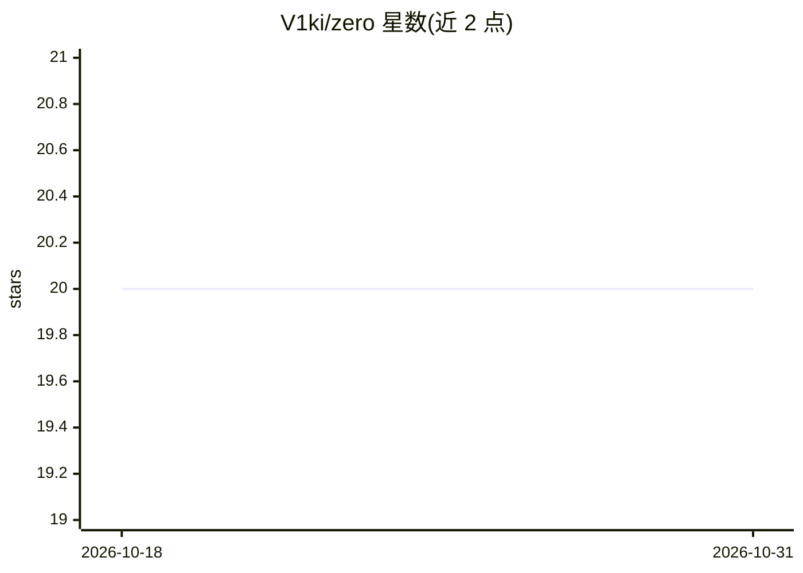

# V1ki/zero

⭐ 20 · TypeScript · MIT · 推送 2026-09-07 · [GitHub](https://github.com/V1ki/zero) · 个人维护 · 中文 README

**本地优先的持久化 AI Agent 运行时操作系统，含 Web 控制台**

Bun + TypeScript monorepo，提供持久化 agent 运行时：跨模型提供商路由、会话/日志/追踪/长期记忆持久化、cron 定时任务、Web/Telegram/飞书/钉钉等渠道适配、React Web 控制平面，以及可选的心跳监控 supervisor 进程（睡眠感知、失败熔断与冷却探测）。Agent 工具覆盖文件读写、shell 执行、URL 抓取、记忆召回与日程创建。支持 ChatGPT/Claude/xAI 多账号 OAuth 接入与模型池故障转移。限制：默认密钥管理流程依赖 macOS（Keychain 与 launchctl）。

## 筛选速览

| 维度 | 判定 | 备注 |
|---|---|---|
| AI 角色 | `ai-ecosystem` | LLM/agent 周边工具 |
| 许可风险 | `permissive` | MIT |
| 部署形态 | `None` |  |
| 模型依赖 | locked-api |  |
| 硬件要求 | — | 无带数字的原话,不猜 |
| 安装摩擦 | `low` | 无编译、无系统依赖或容器化 |
| 成熟度 | — | 结构信号不足 |

## 能力要点

- ModelRouter 跨提供商路由，OAuth 多账号与模型池配额感知故障转移
- Telegram/飞书/钉钉/Web 多渠道接入与消息归一化
- supervisor 心跳监控：睡眠感知、五次修复失败后熔断并按 30 分钟冷却自动探测
- Markdown 记忆 + 向量索引检索，加密 vault 与 shell 安全规则

## 适用场景

- 在本机长期运行一个可接入多渠道聊天的 AI agent
- 通过 Web 控制台管理会话、记忆、日志与模型配置
- 让 agent 定时执行 cron 任务并自动从故障中恢复

## 场景标签

`Agent 框架` `Agent 记忆` · 领域:Agent 开发

## 证据(README 行号)

> L5: ZeRo OS is a Bun + TypeScript monorepo for running a persistent agent runtime with tools,
> L66: 5. `ModelRouter` selects the configured model/provider.

## 星数曲线

2026-10-18 20 → 2026-10-31 20（+0）

---
*卡片 v1 · prompt 1.4 · 生成 2026-10-28 · 置信度 high · 依据 README sha `7c03a254938e` · [字段定义](../../DATASET.md)*
