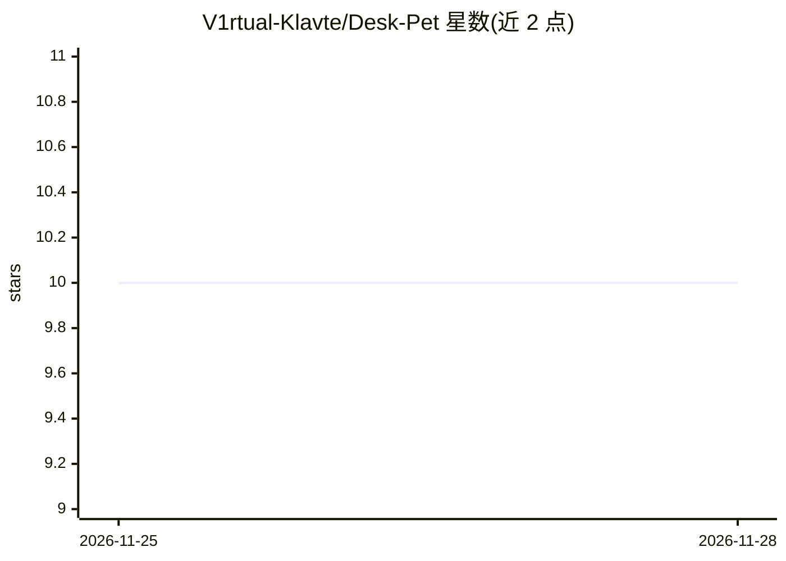

# V1rtual-Klavte/Desk-Pet

⭐ 10 · TypeScript · MIT · 推送 2026-11-02 · [GitHub](https://github.com/V1rtual-Klavte/Desk-Pet) · 个人维护 · 中文 README

**常驻桌面的 AI 陪伴桌宠：聊天、记忆与工具执行**

Rust 原生宿主 + 随包分发 Node 运行时的桌面宠物应用，角色以透明置顶窗口常驻桌面。支持人格卡与图层自定义、多会话与上下文压缩、截图观察前台窗口的静默了解、带来源校验的长期记忆、按档位的主动消息，以及文件读写、Bash、截图、MCP/Skill 等工具调用，执行受统一权限策略约束。安装包未签名，首次打开需手动放行；macOS 窗口观察需辅助功能授权。模型侧走 OpenAI 兼容接口，需配置 API Key。

## 筛选速览

| 维度 | 判定 | 备注 |
|---|---|---|
| AI 角色 | `ai-native` | 本体是模型或模型工具 |
| 许可风险 | `permissive` | MIT |
| 部署形态 | `desktop` | 安装包/桌面程序 |
| 模型依赖 | local-ok | 支持本地模型 |
| 硬件要求 | — | 无带数字的原话,不猜 |
| 安装摩擦 | `low` | 无编译、无系统依赖或容器化 |
| 成熟度 | — | 结构信号不足 |

## 能力要点

- 人格卡与变量机制：同一桌宠可切换多张卡，变量随卡持久化
- 静默了解：截图观察前台窗口，宿主逐项校验、整机只读
- 长期记忆：可信来源自动提交，支持查看原话、纠正与遗忘
- 内置工具与 MCP/Skill 扩展，未启用服务器不连接不驻留

## 适用场景

- 想要一个能陪聊并记住我的桌面角色
- 让桌宠帮我读写文件、执行命令、做定时提醒
- 自定义人格与立绘，用生图提示词生成图层素材

## 场景标签

`聊天机器人` `AI 助手` · 领域:对话与助手

## 证据(README 行号)

> L23: V1rtual-Desk-Pet 是一款**可自定义 人格卡 / 图层 的桌面宠物**，优先做好轻量陪伴与聊天。
> L25: 角色以透明置顶窗口常驻桌面：可以陪聊、感知前台窗口并在合适的时候主动搭话，也能调用工具完成文件读写、命令执行与任务编排。整个应用由 Rust 原生宿主（含原生 UI 与平台能力）与一个随包分发的 Node 运行时组成，**没有 W
> L98: - **出网请求只发生在模型服务、网页抓取、更新检查与 MCP 远程连接**：模型侧为 OpenAI 兼容接口（默认 DeepSeek，也支持 OpenAI / Ollama / LM Studio 等），Provider 调用单

## 星数曲线

2026-11-25 10 → 2026-11-28 10（+0）

---
*卡片 v1 · prompt 1.4 · 生成 2026-11-24 · 置信度 high · 依据 README sha `b5722424e2f7` · [字段定义](../../DATASET.md)*
