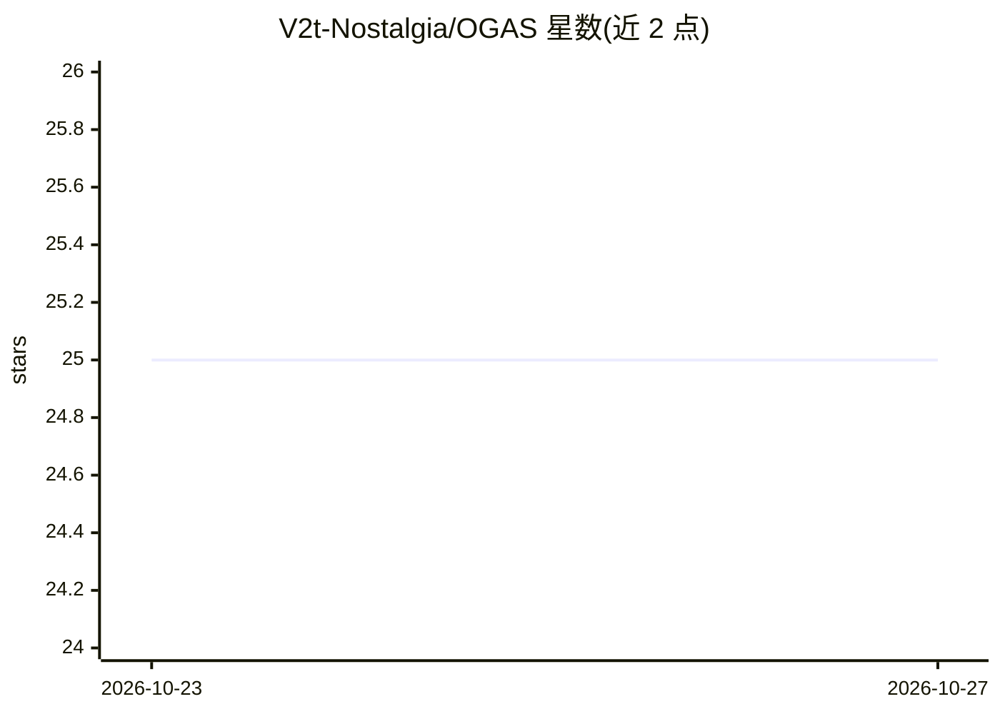

# V2t-Nostalgia/OGAS

⭐ 25 · Python · GPL-3.0 · 推送 2026-10-20 · [GitHub](https://github.com/V2t-Nostalgia/OGAS) · [官网](https://github.com/V2t-Nostalgia/OGAS#readme) · 组织维护 · 中文 README

**Stellaris 帝国治理的专家 AI agent 系统（源码 alpha）**

面向 Stellaris 的 AI 代理系统：读取游戏状态，由经济、科研、舰队等独立 agent 生成持久计划，经 Broker 校验契约、权限与候选合法性后执行。包含原生 Command 研究（4.5.2 上构造 310 个 Command 类、174 个通过 IsValid 的探测记录）、Linux SDK 符号恢复与独立证据仓库。当前为 v0.6.0-alpha.1 源码研究检查点，无安装包，原生执行仍处于实验门槛之下，需自备合法游戏安装。

## 筛选速览

| 维度 | 判定 | 备注 |
|---|---|---|
| AI 角色 | `ai-native` | 本体是模型或模型工具 |
| 许可风险 | `viral` | GPL-3.0 |
| 部署形态 | `library` | 以包/库形式分发 |
| 模型依赖 | — | README 未给出锁定关系 |
| 硬件要求 | — | 无带数字的原话,不猜 |
| 安装摩擦 | `low` | 无编译、无系统依赖或容器化 |
| 成熟度 | `idea` | |

## 能力要点

- 经济/科研/舰队分离 agent，各自独立工具、历史与模型绑定
- Broker 执行层校验契约、权限、候选与快照新鲜度
- 4.5.2 原生合法性研究：310 个 Command 类构造、174 个 IsValid 探测
- Web 控制台与可选 Qt overlay 交互，带签名索引的证据仓库

## 适用场景

- 让 AI agent 在 Stellaris 战役中持续治理帝国并解释决策
- 研究游戏原生命令构造与合法执行路径
- 基于源码二次开发与自动化实验复现

## 场景标签

`多智能体` · 领域:Agent 开发

## 证据(README 行号)

> L5: Specialist AI agents for sustained empire governance in **Stellaris**.
> L7: OGAS connects game-state observation, domain-specific agents, persistent plans,
> L28: Economy, research and fleet agents have separate tools, histories and model

## 星数曲线

2026-10-23 25 → 2026-10-27 25（+0）

---
*卡片 v1 · prompt 1.4 · 生成 2026-10-27 · 置信度 mid · 依据 README sha `43baabaf6077` · [字段定义](../../DATASET.md)*
