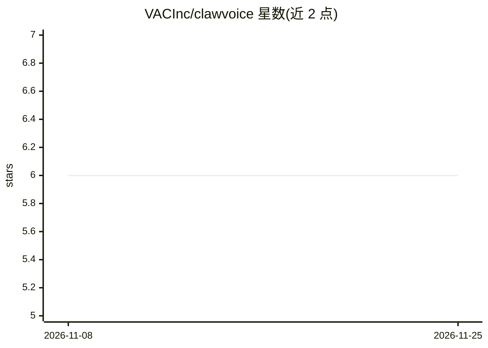

# VACInc/clawvoice

⭐ 6 · Python · MIT · 推送 2026-11-05 · [GitHub](https://github.com/VACInc/clawvoice) · 个人维护

**为 OpenClaw 与 Home Assistant 搭建的全本地语音栈**

一个家庭语音方案的开源实现集：以 OpenAI Realtime websocket 协议兼容的本地 shim 为核心，后接本地 STT（Parakeet）、本地 LLM（vLLM 部署的 Qwen3.8 或 DeepSeek）、本地 TTS（Chatterbox）与说话人识别（ReDimNet/TitaNet），覆盖唤醒词音箱、OpenClaw Talk 模式、真实电话（Twilio）与 Discord 语音四条链路；本地模型只负责快声回复，复杂任务通过 consult 机制交给主 agent。文档明确说明这是家庭环境的工作记录而非产品，主机名为占位符。

## 筛选速览

| 维度 | 判定 | 备注 |
|---|---|---|
| AI 角色 | `ai-ecosystem` | LLM/agent 周边工具 |
| 许可风险 | `permissive` | MIT |
| 部署形态 | `library` | 以包/库形式分发 |
| 模型依赖 | local-ok | 支持本地模型 |
| 硬件要求 | — | 无带数字的原话,不猜 |
| 安装摩擦 | `medium` | 含编译或系统依赖之一 |
| 成熟度 | — | 结构信号不足 |

## 能力要点

- 本地 shim 兼容 OpenAI Realtime websocket 协议，伪装为 OpenAI 端点
- 语音链路端到端延迟实测约 0.55-0.76 秒
- consult 机制：本地快模型说话，复杂任务移交云端或更强本地模型
- 说话人识别带置信阈值（0.72/0.55）与 fail-closed 策略

## 适用场景

- 给 Home Assistant 音箱接入全本地语音识别与合成
- 让 OpenClaw 通过语音对话并保留主 agent 处理复杂任务
- 用本地模型接听和拨打电话并与 agent 对话
- 识别家中说话人身份并按身份限制可执行功能

## 场景标签

`语音 Agent` · 领域:对话与助手

## 证据(README 行号)

> L3: A local voice stack for OpenClaw and Home Assistant: wake-word speakers, the OpenClaw app/web UI Talk mode, real pho
> L11: |`shim/`|The realtime shim: OpenAI Realtime websocket API in front of local STT/LLM/TTS. Powers Talk, phone calls a
> L35: The trick that makes everything else work: **the shim**. OpenClaw's Talk mode, voice-call plugin and Discord voice 

## 星数曲线

2026-11-08 6 → 2026-11-25 6（+0）

---
*卡片 v1 · prompt 1.4 · 生成 2026-11-20 · 置信度 high · 依据 README sha `c1d6d2fc1f44` · [字段定义](../../DATASET.md)*
