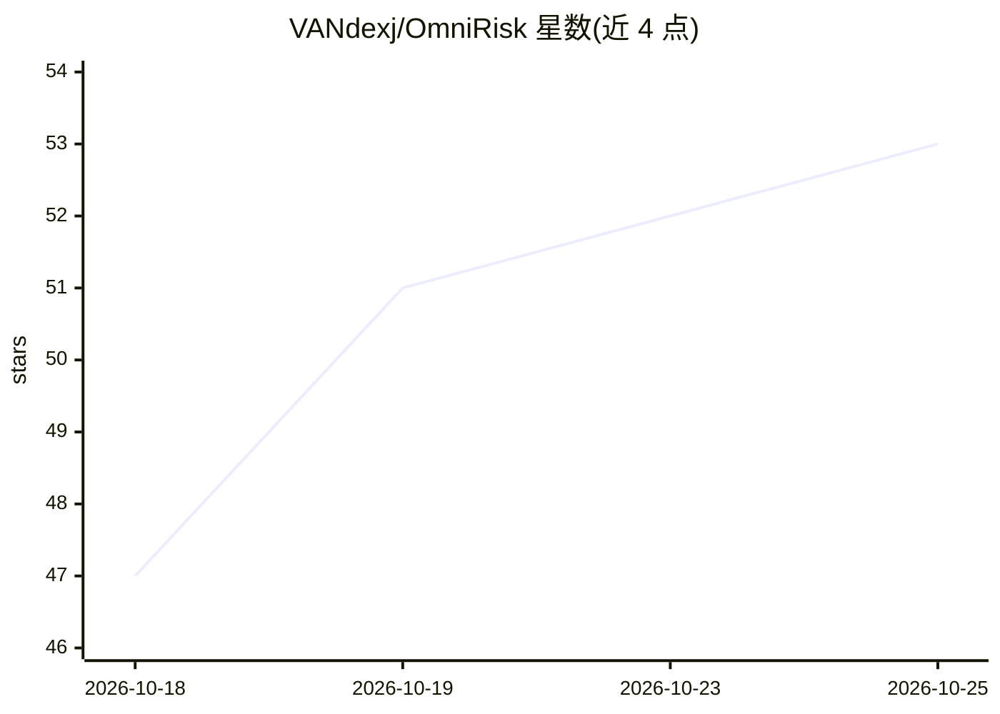

# VANdexj/OmniRisk

⭐ 54 · C++ · NOASSERTION · 推送 2026-10-25 · [GitHub](https://github.com/VANdexj/OmniRisk) · [官网](https://arxiv.org/abs/2609.18191) · 组织维护

**四旋翼全向轨迹风险学习：机载一次前向评估全部机动避障**

面向敏捷四旋翼动态避障的学习型规划器：用神经网络一次前向传播对无人机周围 36 个候选机动评分，把轨迹风险评估从离线搬到机载，规划开销不随障碍物数量增长。结合 LiDAR 与运动目标检测输入，在 Jetson Orin NX 上 20 ms 完成网络推理；提供 ROS 机载栈、CUDA 仿真器与数据集生成、预训练权重、TensorRT 加速及 Docker 镜像，实测 15 m/s 相对遭遇速度下实机避障。

## 筛选速览

| 维度 | 判定 | 备注 |
|---|---|---|
| AI 角色 | `ai-native` | 本体是模型或模型工具 |
| 许可风险 | `none` | NOASSERTION |
| 部署形态 | `None` |  |
| 模型依赖 | — | README 未给出锁定关系 |
| 硬件要求 | — | 无带数字的原话,不猜 |
| 安装摩擦 | `medium` | 含编译或系统依赖之一 |
| 成熟度 | — | 结构信号不足 |

## 能力要点

- 一次前向传播评分 36 个候选机动，规划开销不随障碍物数增长
- 实机零微调：15 m/s 相对遭遇速度，室内 90.7%/室外 86.7% 成功率（n=150）
- 提供 CUDA LiDAR/深度仿真器与数据集生成、预训练权重下载
- TensorRT 加速部署，Jetson Orin NX 上网络推理 20 ms

## 适用场景

- 四旋翼在飞行中对抛掷物等动态障碍实时避障
- 在仿真中生成数据并训练轨迹风险网络
- 将预训练模型部署到 Jetson 机载平台实机飞行

## 场景标签

 · 领域:机器人/无人机自主飞行

## 证据(README 行号)

> L22: OmniRisk moves trajectory-risk evaluation **offline**. Onboard, one forward pass scores every candidate
> L23: maneuver around the drone, so planning cost **does not grow with the number of obstacles**.

## 星数曲线

2026-10-18 47 → 2026-10-25 53（+6）

---
*卡片 v1 · prompt 1.4 · 生成 2026-10-24 · 置信度 high · 依据 README sha `f2cb932bc282` · [字段定义](../../DATASET.md)*
