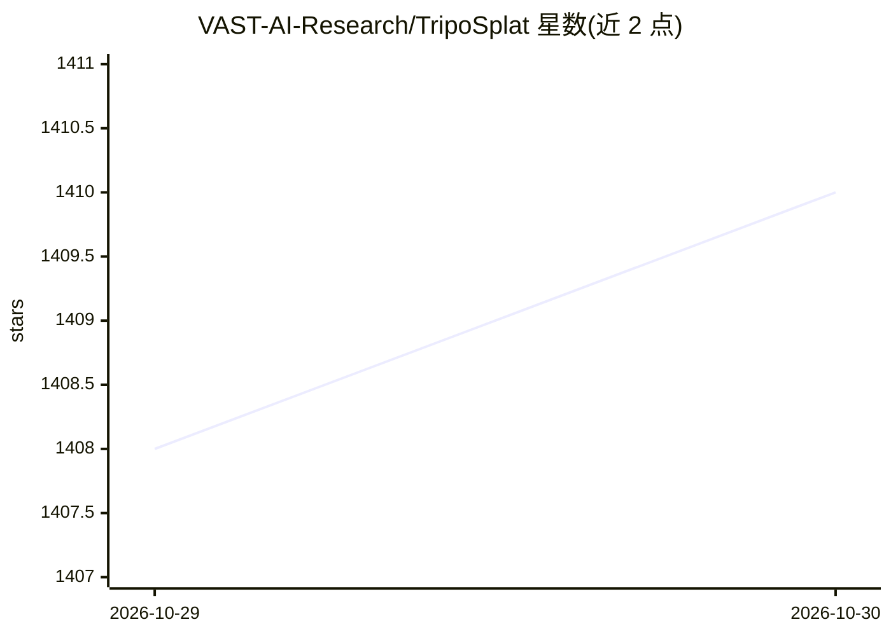

# VAST-AI-Research/TripoSplat

⭐ 1,410 · Python · MIT · 推送 2026-08-13 · [GitHub](https://github.com/VAST-AI-Research/TripoSplat) · [官网](https://www.tripo3d.ai/research/triposplat) · 组织维护

**单张 2D 图像生成可变数量 3D 高斯的推理模型**

由 TripoAI 开发的图生 3D 高斯模型推理仓库：输入单张 2D 图像，输出最多 262,144 个 3D 高斯，导出 .ply/.splat 文件可在任意高斯查看器中渲染。代码仅约 2,000 行、两个文件，不依赖 transformers/diffusers，需自行安装 torch/torchvision 及少量依赖，模型权重从 HuggingFace 下载。官方提供 ComfyUI 工作流模板与 Gradio 演示，MIT 许可，训练代码在另一仓库。

## 筛选速览

| 维度 | 判定 | 备注 |
|---|---|---|
| AI 角色 | `ai-native` | 本体是模型或模型工具 |
| 许可风险 | `permissive` | MIT |
| 部署形态 | `library` | 以包/库形式分发 |
| 模型依赖 | — | README 未给出锁定关系 |
| 硬件要求 | — | 无带数字的原话,不猜 |
| 安装摩擦 | `low` | 无编译、无系统依赖或容器化 |
| 成熟度 | — | 结构信号不足 |

## 能力要点

- 单图生成任意数量（上限 262,144）的 3D 高斯
- 近零依赖：不依赖 transformers/diffusers，代码约 2,000 行两个文件
- 官方 ComfyUI 工作流模板支持
- 导出 .ply/.splat 文件用于可视化与资产制作

## 适用场景

- 用一张图片快速生成 3D 高斯资产用于游戏或 AR/VR
- 在 ComfyUI 中以工作流方式生成 3D 内容
- 在质量与渲染成本之间按高斯数量调节取舍

## 场景标签

 · 领域:3D 生成/计算机视觉

## 证据(README 行号)

> L1: # TripoSplat
> L13: - **High-quality, versatile generation** that handles a wide range of image styles.

## 星数曲线

2026-10-29 1,408 → 2026-10-30 1,410（+2）

---
*卡片 v1 · prompt 1.4 · 生成 2026-10-28 · 置信度 high · 依据 README sha `68fa0b9f5f6b` · [字段定义](../../DATASET.md)*
