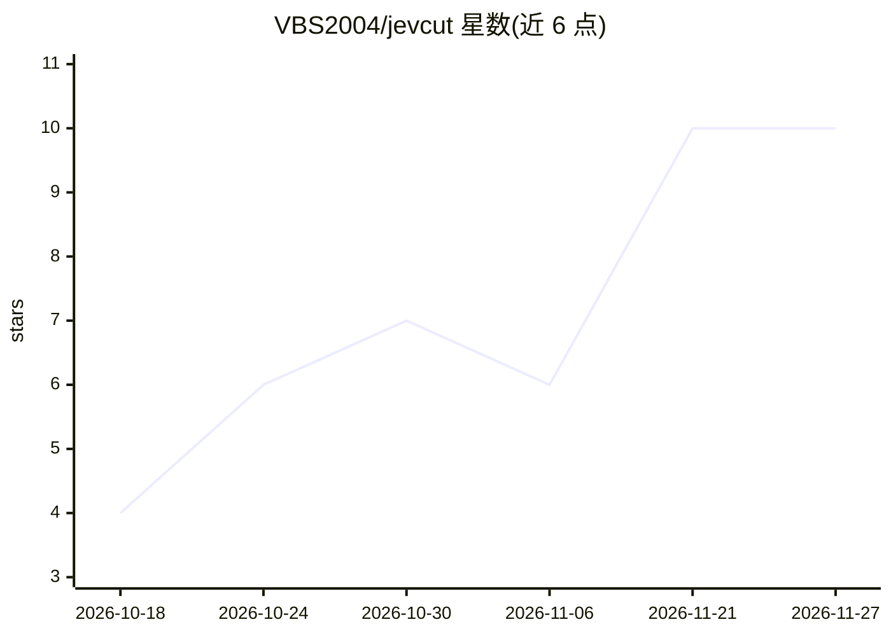

# VBS2004/jevcut

⭐ 10 · Python · MIT · 推送 2026-11-23 · [GitHub](https://github.com/VBS2004/jevcut) · 个人维护

**把长视频自动剪成 Shorts/Reels/TikTok 短片段的命令行工具**

面向播客、演讲、访谈等口播内容的自动剪辑工具：先转写视频，由代码枚举所有候选剪切点（句尾、停顿、说话人变化），再由模型逐一判断候选片段是否成立、能否独立成篇，剔除广告后输出按排名排序的 mp4 及观看页面。模型只做判断、从不生成时间戳，并设有独立成篇的显式检查门。在 38 个人工标注视频上给出基准数据；v1 仅处理含语言内容的视频，无语音片段无法识别。

## 筛选速览

| 维度 | 判定 | 备注 |
|---|---|---|
| AI 角色 | `ai-native` | 本体是模型或模型工具 |
| 许可风险 | `permissive` | MIT |
| 部署形态 | `None` |  |
| 模型依赖 | locked-api |  |
| 硬件要求 | — | 无带数字的原话,不猜 |
| 安装摩擦 | `medium` | 含编译或系统依赖之一 |
| 成熟度 | `idea` | |

## 能力要点

- 代码枚举全部候选剪切边缘，模型仅做判断、不生成时间戳
- 对每条候选边缘做独立成篇检查，无法通过的片段一律不输出
- 级联结构：窗口扫描定位锚点后仅在其附近评估候选片段，约 520 次请求/小时
- 在 38 个跨 13 类别的人工标注视频上给出召回率、精确率等基准数字

## 适用场景

- 把小时级播客批量切出可独立观看的短视频片段
- 为 Shorts/Reels/TikTok 生成按质量排序的素材库
- 对直播内容做回看缓冲式的实时切片

## 场景标签

`图像视频处理` · 领域:感知与多模态

## 证据(README 行号)

> L12: jevcut transcribes the video, finds the moments worth clipping, decides exactly where
> L16: **What makes it different:** code lists every place a clip could start or end — sentence
> L30: **Scope: v1 clips verbal content** — podcasts, interviews, talks, panels, comedy, streams

## 星数曲线

2026-10-18 4 → 2026-11-27 10（+6）

---
*卡片 v1 · prompt 1.4 · 生成 2026-11-21 · 置信度 high · 依据 README sha `d92ade6c272e` · [字段定义](../../DATASET.md)*
