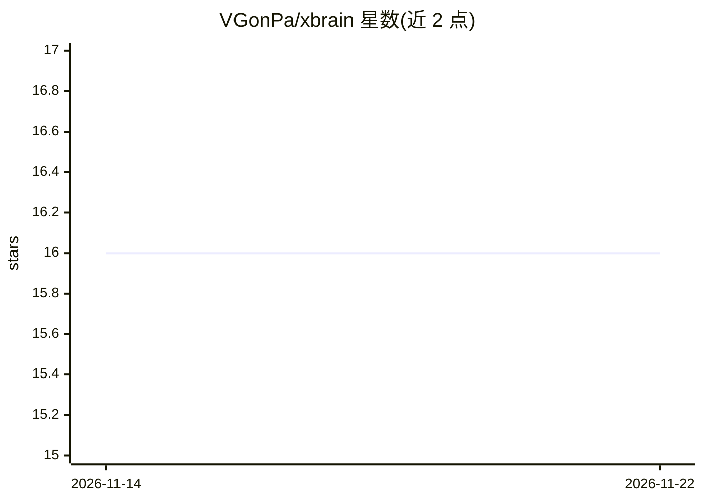

# VGonPa/xbrain

⭐ 16 · Python · MIT · 推送 2026-11-14 · [GitHub](https://github.com/VGonPa/xbrain) · 个人维护

**把 X 书签与推文转成可检索的 Obsidian 三层知识库**

面向使用 X 收藏内容并已在 Obsidian 中记笔记的个人用户的 CLI 工具：抓取用户自己的 X 书签与推文，存为结构化 JSON，生成分条目/主题/索引三层交叉链接的 markdown wiki，每条含 LLM 摘要与内联抓取的链接文章；视频书签可转录并生成摘要。默认通过 Claude Code 会话执行 LLM 阶段，无需付费 API，也支持 ANTHROPIC_API_KEY 的 api 模式。输出语言当前固定（西班牙语），语言切换在路线图中；视频处理依赖可选的外部 ffmpeg、parakeet-mlx、mlx-vlm。

## 筛选速览

| 维度 | 判定 | 备注 |
|---|---|---|
| AI 角色 | `ai-native` | 本体是模型或模型工具 |
| 许可风险 | `permissive` | MIT |
| 部署形态 | `library` | 以包/库形式分发 |
| 模型依赖 | — | README 未给出锁定关系 |
| 硬件要求 | — | 无带数字的原话,不猜 |
| 安装摩擦 | `medium` | 含编译或系统依赖之一 |
| 成熟度 | — | 结构信号不足 |

## 能力要点

- X 书签/推文 → 三层交叉链接 Obsidian wiki（Items/Topics/Index）
- 默认 Claude Code 会话执行 LLM 阶段，无需付费 API
- 视频转录与 --frames 视觉模型帧描述，纳入主题与摘要
- 生成单文件交互式 dashboard.html（九个面板）

## 适用场景

- 把 X 书签积攒的线程/文章变成可检索的笔记库
- 让收藏的文章、视频与已有 Obsidian 笔记互相链接
- 对自己的收藏做主题综述与统计浏览

## 场景标签

`知识库管理` `网页抓取` · 领域:效率与自动化

## 证据(README 行号)

> L14: XBrain digs it up. It extracts your X bookmarks and your own posts, stores them
> L19: It runs locally. The LLM work needs **no paid API** — a Claude Code session does

## 星数曲线

2026-11-14 16 → 2026-11-22 16（+0）

---
*卡片 v1 · prompt 1.4 · 生成 2026-11-18 · 置信度 high · 依据 README sha `25daad599385` · [字段定义](../../DATASET.md)*
