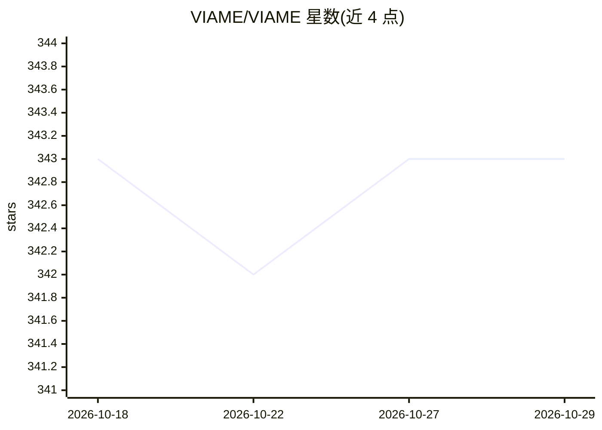

# VIAME/VIAME

⭐ 343 · Python · NOASSERTION · 推送 2026-10-09 · [GitHub](https://github.com/VIAME/VIAME) · [官网](http://www.viametoolkit.org/) · 组织维护

**面向科研的计算机视觉工具包：目标检测、跟踪、标注与训练**

VIAME 是支持自助式 AI 的计算机视觉应用与工具包，功能包括目标检测、跟踪、数据标注、多相机处理、尺寸测量、图像增强、快速模型生成、基于查询的搜索、拼接与算法评测。最初面向海洋物种分析，现可作为通用 CV 工具包使用。底层提供可多线程连接 C++/Python 节点的 pipeline 框架，算法集成于桌面与 Web 界面（DIVE）。分发形式含 Windows/Linux 桌面二进制包、Docker 镜像与 PyPI 包；GPU 版需 NVIDIA 驱动 570.65+，CPU 版无需；macOS 仅支持 Web 与独立标注工具。

## 筛选速览

| 维度 | 判定 | 备注 |
|---|---|---|
| AI 角色 | `ai-native` | 本体是模型或模型工具 |
| 许可风险 | `none` | NOASSERTION |
| 部署形态 | `desktop` | 安装包/桌面程序 |
| 模型依赖 | — | README 未给出锁定关系 |
| 硬件要求 | `cpu-ok` | |
| 安装摩擦 | `high` | 编译与系统依赖俱全 |
| 成熟度 | — | 结构信号不足 |

## 能力要点

- 目标检测、跟踪、标注、训练、评测于一体的 CV 工具链
- C++/Python 节点可多线程连接的 pipeline 框架
- 提供桌面二进制、Docker、PyPI（Python 3.10-3.14）多种分发形式
- 配套 DIVE 桌面/Web 标注界面与公开标注档案库

## 适用场景

- 对海洋/生态视频做物种检测、跟踪与计数分析
- 为图像视频数据集做标注并训练检测模型
- 评测与对比计算机视觉算法流水线

## 场景标签

`目标检测` `科研工具` `图像视频处理` · 领域:学习与行业

## 证据(README 行号)

> L3: VIAME is a computer vision application designed for do-it-yourself artificial intelligence
> L7: VIAME now contains many algorithms and libraries, and is useful as a generic computer vision

## 星数曲线

2026-10-18 343 → 2026-10-29 343（+0）

---
*卡片 v1 · prompt 1.4 · 生成 2026-10-21 · 置信度 high · 依据 README sha `3da3b3ac37be` · [字段定义](../../DATASET.md)*
