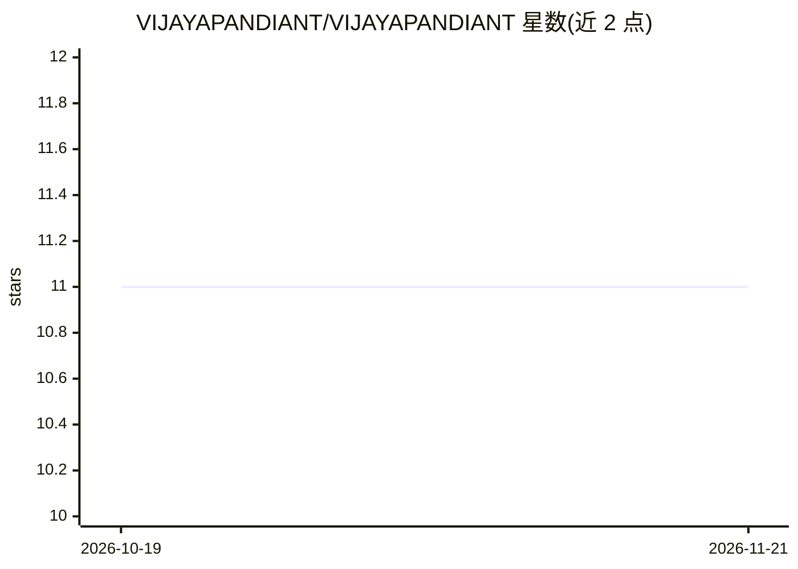

# VIJAYAPANDIANT/VIJAYAPANDIANT

⭐ 11 · 推送 2026-11-14 · [GitHub](https://github.com/VIJAYAPANDIANT/VIJAYAPANDIANT) · [官网](https://github.com/VIJAYAPANDIANT) · 个人维护

**计算机专业学生的个人 GitHub 主页：展示技能与项目作品**

这是用户 VIJAYAPANDIANT 的个人 profile README，用于展示个人形象而非提供可运行的软件。内容包含自我介绍（在读本科生）、技能清单（Java/Python/React 等前后端与数据库技术）、正在学习的方向、竞赛编程账号链接，以及 4 个项目卡片的简介（在线考试系统、假新闻检测、板球分析、实时投票平台），各附 Live Demo 与 GitHub 链接。无安装说明、无代码使用方式，仅作为开发者个人主页与作品集入口。

## 筛选速览

| 维度 | 判定 | 备注 |
|---|---|---|
| AI 角色 | `ai-knowledge` | 知识聚合/清单类 |
| 许可风险 | `none` | — |
| 部署形态 | `None` |  |
| 模型依赖 | — | README 未给出锁定关系 |
| 硬件要求 | — | 无带数字的原话,不猜 |
| 安装摩擦 | `low` | 无编译、无系统依赖或容器化 |
| 成熟度 | — | 结构信号不足 |

## 能力要点

- 技能清单：Java、Python、React、Node.js、Spring Boot、多种数据库
- 4 个全栈项目的简介与演示/GitHub 链接
- LeetCode、CodeChef、GeeksforGeeks 竞赛编程账号入口
- 包含在线监考考试系统与 ML 假新闻检测等项目描述

## 适用场景

- 作为求职者查看该学生的技能栈与项目经历
- 通过项目链接浏览其演示站点与源码仓库

## 场景标签

 · 领域:个人主页/作品集

## 证据(README 行号)

> L17: # Hi, I'm Vijayapandian T 👋
> L35: ## 🎯 Top Skills
> L170: ## 🚀 Featured Projects

## 星数曲线

2026-10-19 11 → 2026-11-21 11（+0）

---
*卡片 v1 · prompt 1.4 · 生成 2026-11-18 · 置信度 high · 依据 README sha `a04c38036a59` · [字段定义](../../DATASET.md)*
