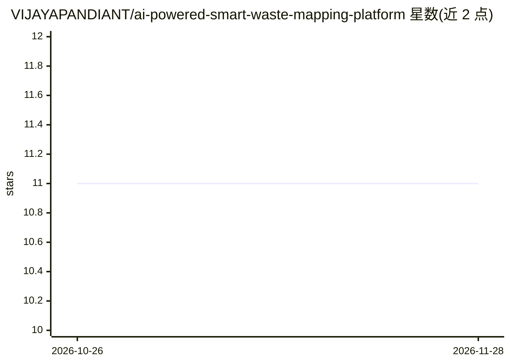

# VIJAYAPANDIANT/ai-powered-smart-waste-mapping-platform

⭐ 11 · JavaScript · 推送 2026-07-08 · [GitHub](https://github.com/VIJAYAPANDIANT/ai-powered-smart-waste-mapping-platform) · [官网](https://ai-powered-smart-waste-mapping-plat.vercel.app) · 个人维护

**面向市民与市政的垃圾热点地图与清理协作平台**

基于 MERN 栈加 Python Flask AI 微服务的智慧城市应用：市民上传带 GPS 坐标的垃圾照片报告热点，通过 Eco Points 积分、排行榜与环保奖励市场实现游戏化激励，并支持社区清理活动组织、Socket.io 实时通知与管理员仪表盘。AI 部分包含 Random Forest 回归模型预测垃圾量与风险等级、最近邻算法为清运车辆做路径优化、基于密度的热点聚类与报告文本的优先级自动分类。提供在线演示站点与演示账号，需分别配置 MongoDB、Cloudinary 等服务后本地运行三个服务。

## 筛选速览

| 维度 | 判定 | 备注 |
|---|---|---|
| AI 角色 | `ai-enhanced` | 去掉 AI 部分产品仍成立 |
| 许可风险 | `none` | — |
| 部署形态 | `library` | 以包/库形式分发 |
| 模型依赖 | — | README 未给出锁定关系 |
| 硬件要求 | — | 无带数字的原话,不猜 |
| 安装摩擦 | `low` | 无编译、无系统依赖或容器化 |
| 成熟度 | — | 结构信号不足 |

## 能力要点

- Random Forest 模型预测垃圾量（吨）与风险等级
- 最近邻路径优化并估算运输时间与省油量
- Eco Points 游戏化积分与环保奖励兑换市场
- MongoDB GeoJSON 地理索引与密度热点聚类

## 适用场景

- 市民拍照上报城市垃圾堆积点并累计环保积分
- 市政部门追踪热点、调度清运车辆路线
- 组织社区街道与海滩清理志愿活动

## 场景标签

`数据分析` · 领域:效率与自动化

## 证据(README 行号)

> L3: Welcome to the **Smart Waste Mapping Platform**, a community-driven, gamified web application designed to help citiz
> L35: - **🤖 AI-Powered Waste & Risk Prediction:** Employs a Machine Learning model (Random Forest Regressor) to predict w
> L56: |**AI Service**|Flask|Machine learning and route-optimization microservice|

## 星数曲线

2026-10-26 11 → 2026-11-28 11（+0）

---
*卡片 v1 · prompt 1.4 · 生成 2026-11-18 · 置信度 mid · 依据 README sha `84f328e12c48` · [字段定义](../../DATASET.md)*
