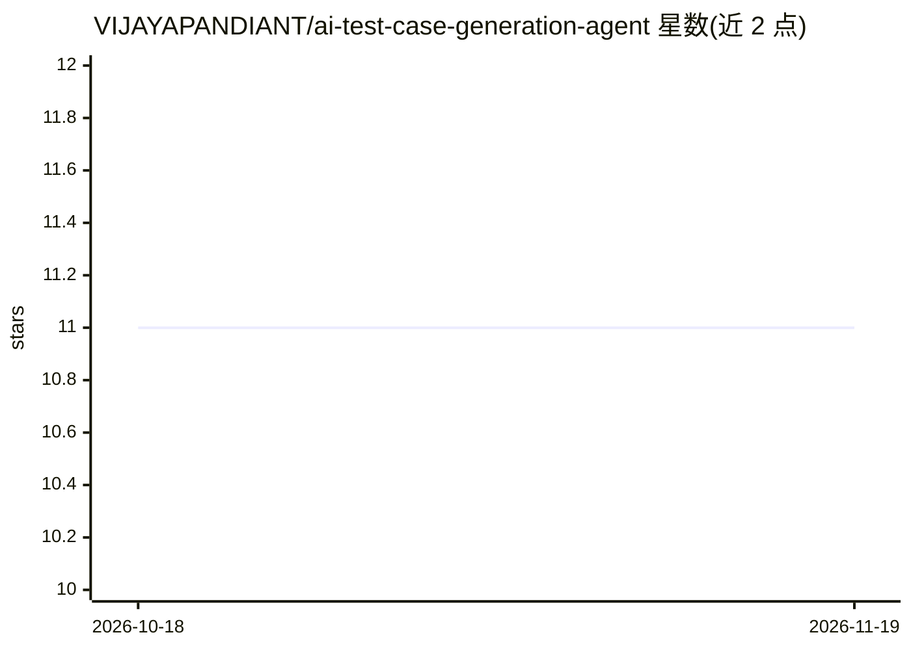

# VIJAYAPANDIANT/ai-test-case-generation-agent

⭐ 11 · TypeScript · 推送 2026-07-09 · [GitHub](https://github.com/VIJAYAPANDIANT/ai-test-case-generation-agent) · [官网](https://ai-test-case-generation-agent.vercel.app) · 个人维护

**给 QA/开发者用 Gemini 从代码和需求生成多类测试用例**

前后端分离的测试用例生成平台：后端为 Node.js/Express REST API，调用 Google Gemini SDK（@google/generative-ai）生成单元、集成、安全、性能与边界等类别的测试断言，覆盖 Jest、Mocha、PyTest、Supertest、Cypress、Playwright 等框架；前端为 Next.js 仪表盘，可粘贴结果。本地运行需 Node.js 18+、npm 与 Gemini API Key，前后端分别 npm install 后以 npm run dev 启动，模型通过 .env 中 GEMINI_MODEL 配置（默认 gemini-1.5-flash）。

## 筛选速览

| 维度 | 判定 | 备注 |
|---|---|---|
| AI 角色 | `ai-native` | 本体是模型或模型工具 |
| 许可风险 | `none` | — |
| 部署形态 | `library` | 以包/库形式分发 |
| 模型依赖 | — | README 未给出锁定关系 |
| 硬件要求 | — | 无带数字的原话,不猜 |
| 安装摩擦 | `low` | 无编译、无系统依赖或容器化 |
| 成熟度 | — | 结构信号不足 |

## 能力要点

- 通过 POST /api/generate 生成多类别测试套件（unit/integration/security/performance 等）
- 覆盖 Jest、Mocha、PyTest、Supertest、Cypress、Playwright 等框架的断言输出
- 提供 Vercel 上的前端仪表盘与后端 API Gateway 在线部署
- 模型可经 .env 的 GEMINI_MODEL 配置，默认 gemini-1.5-flash

## 适用场景

- 从 API 端点或代码快速生成可粘贴的测试断言
- 为注册/校验类接口生成含 SQL 注入与 XSS 检查的安全测试
- 为多步工作流（数据库、路由、服务）生成集成测试

## 场景标签

`代码生成` · 领域:编码与开发

## 证据(README 行号)

> L10: **TestGen AI** is a state-of-the-art test case generator designed to create high-coverage test suites instantly. Ut
> L39: - **AI Core**: Google Gemini SDK (`@google/generative-ai`)

## 星数曲线

2026-10-18 11 → 2026-11-19 11（+0）

---
*卡片 v1 · prompt 1.4 · 生成 2026-11-18 · 置信度 high · 依据 README sha `efa5ea47c216` · [字段定义](../../DATASET.md)*
