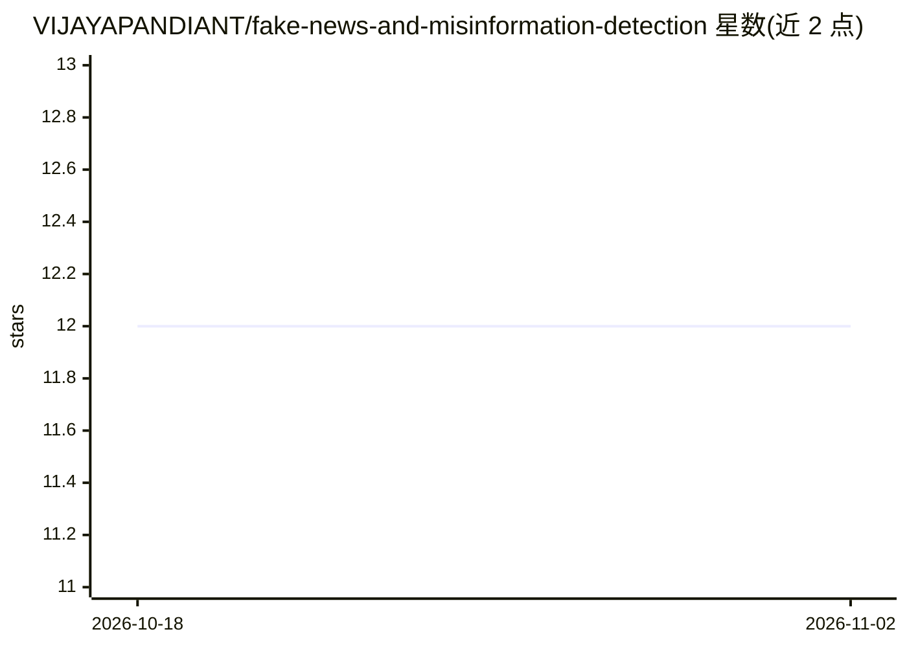

# VIJAYAPANDIANT/fake-news-and-misinformation-detection

⭐ 12 · JavaScript · MIT · 推送 2026-08-21 · [GitHub](https://github.com/VIJAYAPANDIANT/fake-news-and-misinformation-detection) · [官网](https://fake-news-and-misinformation-detect.vercel.app) · 个人维护

**检测假新闻与错误信息的全栈 Web 应用，输出真/假判定**

由 React/Vite 前端、Node.js/Express 后端与 Python FastAPI 机器学习服务组成的全栈应用：ML 服务用 TF-IDF 向量化与 Logistic Regression 模型将输入文章分类为 Real 或 Fake 并给出置信度分数。后端提供 JWT 用户认证、搜索历史与反馈存储（MongoDB），另有管理后台。提供本地运行指南与 Vercel 部署配置；模型可用附带脚本生成合成数据并训练。

## 筛选速览

| 维度 | 判定 | 备注 |
|---|---|---|
| AI 角色 | `ai-native` | 本体是模型或模型工具 |
| 许可风险 | `permissive` | MIT |
| 部署形态 | `library` | 以包/库形式分发 |
| 模型依赖 | — | README 未给出锁定关系 |
| 硬件要求 | — | 无带数字的原话,不猜 |
| 安装摩擦 | `low` | 无编译、无系统依赖或容器化 |
| 成熟度 | — | 结构信号不足 |

## 能力要点

- TF-IDF + Logistic Regression 分类，输出 Real/Fake 与置信度分数
- JWT 认证、历史记录、反馈机制与管理后台
- 前端/后端/ML 服务三段式解耦架构，附 Vercel 部署配置
- 附带合成数据生成与模型训练脚本

## 适用场景

- 输入新闻标题与正文，获得真/假判定与置信度
- 注册账号并追踪自己的检测历史与提交反馈
- 本地克隆后自行训练模型并部署全套服务

## 场景标签

 · 领域:文本分类/内容审核

## 证据(README 行号)

> L3: A complete, production-ready full-stack application designed to analyze and detect fake news and misinformation. The
> L19: 3. **ML Service**: Python FastAPI server utilizing a TF-IDF Vectorizer and a Logistic Regression model to classify 

## 星数曲线

2026-10-18 12 → 2026-11-02 12（+0）

---
*卡片 v1 · prompt 1.4 · 生成 2026-11-01 · 置信度 mid · 依据 README sha `a2ae5bd496c1` · [字段定义](../../DATASET.md)*
